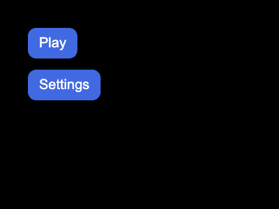
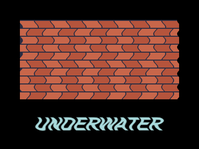

# Your own 2D classes

Every pixi.js class is an element already. A class of your own, or one from another package, becomes one with r3f's `extend`, as a three.js class does in r3f. Name it after the class with a `2D` suffix, so its element reads like pixi's own: `extend({ Button2D: Button })` makes `<button2D>`.

## Display classes

A class that extends one of pixi's containers takes props, `args`, children, refs and events like any 2D element. Its constructor's arguments are its `args`, and its fields and setters its props:

<!-- snippet: examples/2d/extend.example.tsx#result -->

```tsx
import { Canvas, extend } from '@react-fiber/core';
import type { ThreeElement } from '@react-fiber/core';
import { Container, Graphics, Text } from 'pixi.js';

/** A rounded button with a label, built from pixi.js's own classes */
class Button extends Container {
  private readonly _background = new Graphics();
  private readonly _label = new Text({ text: '', style: { fill: 'white', fontSize: 20 } });

  constructor(label = 'Button') {
    super();
    this.addChild(this._background, this._label);
    this.label = label;
  }

  public set label(value: string) {
    this._label.text = value;
    this._label.position.set(16, 10);
    this._background
      .clear()
      .roundRect(0, 0, this._label.width + 32, 44, 12)
      .fill('royalblue');
  }

  public get label(): string {
    return this._label.text;
  }
}

extend({ Button2D: Button });

declare module '@react-fiber/core' {
  interface ThreeElements {
    button2D: ThreeElement<typeof Button>;
  }
}

function Toolbar() {
  return (
    <>
      <button2D args={['Play']} x={40} y={40} />
      <button2D label="Settings" x={40} y={100} />
    </>
  );
}

export function App() {
  return (
    <Canvas>
      <Toolbar />
    </Canvas>
  );
}
```



## Typing the element

`extend` registers the element at runtime; TypeScript learns about it from `ThreeElements`. Add a line per class, with `ThreeElement` for its props:

```tsx
declare module '@react-fiber/core' {
  interface ThreeElements {
    button2D: ThreeElement<typeof Button>;
  }
}
```

## Filters of your own

A filter is a class too. This one shifts each row of pixels along a sine wave, with a GLSL program for WebGL and a WGSL one for WebGPU, and a `time` setter for its uniform:

<!-- snippet: examples/2d/custom-filter.example.tsx#class -->

```tsx
type WaveUniforms = { uTime: { value: number; type: 'f32' }; uAmplitude: { value: number; type: 'f32' } };

/** Shifts each row of pixels along a sine wave, which moves with `time` */
class WaveFilter extends Filter {
  constructor({ amplitude = 0.02 }: { amplitude?: number } = {}) {
    super({
      glProgram: GlProgram.from({ vertex: defaultFilterVert, fragment: GLSL, name: 'wave-filter' }),
      gpuProgram: GpuProgram.from({
        vertex: { source: WGSL, entryPoint: 'mainVertex' },
        fragment: { source: WGSL, entryPoint: 'mainFragment' },
      }),
      resources: {
        wave: new UniformGroup<WaveUniforms>({
          uTime: { value: 0, type: 'f32' },
          uAmplitude: { value: amplitude, type: 'f32' },
        }),
      },
    });
  }

  public get time(): number {
    return (this.resources.wave as UniformGroup<WaveUniforms>).uniforms.uTime;
  }

  public set time(value: number) {
    (this.resources.wave as UniformGroup<WaveUniforms>).uniforms.uTime = value;
  }
}

extend({ WaveFilter2D: WaveFilter });

declare module '@react-fiber/core' {
  interface ThreeElements {
    waveFilter2D: ThreeElement<typeof WaveFilter>;
  }
}
```

As an element it attaches to its parent's `filters`, and `useFrame` moves it through its ref:

<!-- snippet: examples/2d/custom-filter.example.tsx#use -->

```tsx
function Wavy() {
  const bricks = useTexture('/textures/bricks.png');
  const wave = useRef<WaveFilter>(null);

  useFrame((_, delta) => {
    wave.current!.time += delta * 4;
  });

  return (
    <container2D>
      <tilingSprite2D texture={bricks} x={40} y={40} width={320} height={160} />
      <text2D
        text="UNDERWATER"
        anchor={0.5}
        x={200}
        y={250}
        style={{ fill: '#a8dadc', fontFamily: 'Arial', fontSize: 36, fontWeight: 'bold' }}
      />
      <waveFilter2D ref={wave} attach="filters-0" args={[{ amplitude: 0.01 }]} />
    </container2D>
  );
}
```



A one-off filter needs no class: `<filter2D args={[{ glProgram, gpuProgram, resources }]} />` builds pixi's `Filter` from its options. The shader sources are in the example above.

## Classes from other packages

A package of pixi.js classes, such as pixi-filters, needs nothing else: extend the classes you use, and their elements work as pixi's do. See [Filters, masks and blend modes](filters-and-masks-2d.md).
