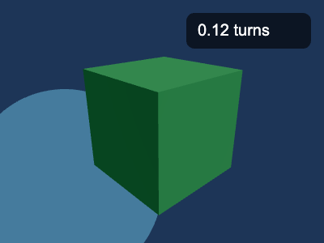

# The screen layer

The 2D elements placed directly in a `<Canvas>` are children of the root's screen layer, a pixi.js container drawn in screen space: CSS pixels from the canvas's top-left corner, as in pixi. It covers the canvas and follows its size; `useThree` hands out both:

```tsx
const { width, height } = useThree((state) => state.size);
const screen = useThree((state) => state.screen);
const pixi = useThree((state) => state.renderer.pixi);
```

`state.screen` is the screen layer's container, and `state.renderer.pixi` the pixi.js renderer, for pixi code that needs them.

## Over and behind the 3D

The scene's 3D is drawn by a pixi-3d view, which sits in the screen layer's 3D layer, at a `zIndex` just under 0. A 2D element at the default `zIndex` of 0, or above, draws over the 3D: a HUD. One with a negative `zIndex` draws behind it: a backdrop. Only the `zIndex` of the 2D elements directly in the Canvas counts; nested ones sort among their siblings.

<!-- snippet: examples/2d/hud.example.tsx#hud -->

```tsx
function Hud({ turns }: { turns: number }) {
  const { width } = useThree((state) => state.size);

  return (
    <container2D x={width - 170} y={16}>
      <graphics2D draw={(graphics) => graphics.roundRect(0, 0, 154, 44, 10).fill({ color: 'black', alpha: 0.6 })} />
      <text2D text={`${turns.toFixed(2)} turns`} x={14} y={10} style={{ fill: 'white', fontSize: 20 }} />
    </container2D>
  );
}
```

<!-- snippet: examples/2d/hud.example.tsx#backdrop -->

```tsx
function Backdrop() {
  const { width, height } = useThree((state) => state.size);

  return (
    <graphics2D
      zIndex={-1}
      draw={(graphics) =>
        graphics.rect(0, 0, width, height).fill({ color: '#1d3557' }).circle(80, 230, 120).fill('#457b9d')
      }
    />
  );
}
```



A colour `background` on the Canvas, or the scene's, is behind everything; a 2D backdrop draws over it.

## A canvas of 2D alone

A Canvas whose scene holds only 2D (and the default camera) makes no pixi-3d view: it costs a 2D renderer and nothing more, until a 3D object joins it.

## 2D inside 3D, and 3D inside 2D

A 2D element inside a 3D object, such as a `<sprite2D>` in a `<mesh>`, follows the object on screen, and `<anchor2D>` does the same with more control. A 3D element can't be a child of a 2D one: it is left out with a warning. To draw 3D inside the 2D, use `<View3D>`. Both, and the 3D layer that holds the canvas's 3D, are in [Mixing 2D and 3D](mixing-2d-and-3d.md). A scene that a portal renders, such as a HUD scene of its own, has a screen layer too.
