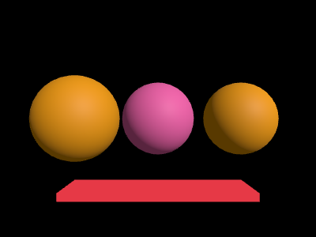

# Events

@pixi/3d's nodes take react-three-fiber's pointer events: `onClick`, `onDoubleClick`, `onContextMenu`, `onPointerOver`, `onPointerOut`, `onPointerEnter`, `onPointerLeave`, `onPointerMove`, `onPointerDown`, `onPointerUp`, `onWheel` and `onPointerMissed`, with react-three-fiber's bubbling, `stopPropagation` and pointer capture. pixi's own event system stays off.

<!-- snippet: examples/3d/events.example.tsx#hover -->

```tsx
function Ball({ x }: { x: number }) {
  const [hovered, setHovered] = useState(false);
  const [clicks, setClicks] = useState(0);

  return (
    <mesh3D
      position={[x, 0, 0]}
      scale={1 + clicks * 0.2}
      hitVolume="geometry"
      onPointerOver={() => setHovered(true)}
      onPointerOut={() => setHovered(false)}
      onClick={(event: ThreeEvent<MouseEvent>) => {
        event.stopPropagation();
        setClicks((count) => count + 1);
      }}
    >
      <sphereGeometry3D args={[{ radius: 0.7 }]} />
      <material3D baseColor={hovered ? 'hotpink' : 'orange'} roughness={0.6} />
    </mesh3D>
  );
}
```



## What is hit

A pointer event casts a ray from the camera through the pointer, and each node is picked as @pixi/3d picks it, by its `hitVolume`:

- A mesh with no `hitVolume` is picked by its geometry's bounding box, @pixi/3d's default, which is cheap and generous: the corners of a sphere's box count.
- `hitVolume="geometry"` picks a mesh by its triangles, and only then does a hit carry the `normal`, `uv` and `triangleIndex` of the triangle.
- `"box"` is the mesh's bounding box, said outright. A @pixi/3d `Box` or `Sphere`, in the node's own space, or another geometry picks the node by that shape, which also lets a container with no geometry of its own take events: `hitVolume={new Sphere(new Vector3(), 1)}`.
- `eventMode="none"` leaves a node out, and `interactiveChildren={false}` leaves out its children. Hidden nodes aren't hit.

Every node along the ray is hit, nearest first, not only the nearest: a click goes to each, front to back, until a handler calls `stopPropagation()`.

## Bubbling

A hit bubbles from the node up its parents, as in react-three-fiber, so a handler on a container hears its children:

<!-- snippet: examples/3d/events.example.tsx#bubbling -->

```tsx
function Rack() {
  const [missed, setMissed] = useState(0);

  return (
    <container3D onClick={() => setMissed(0)} onPointerMissed={() => setMissed((count) => count + 1)}>
      <Ball x={-1.6} />
      <Ball x={0} />
      <Ball x={1.6} />
      <mesh3D position={[0, -1.4, 0]} scale={[3.6, 0.15, 1]}>
        <cubeGeometry3D />
        <flatMaterial3D baseColor={missed > 0 ? '#e63946' : '#555555'} />
      </mesh3D>
    </container3D>
  );
}
```

The balls stop their clicks, so the container hears a click only on the bar, and `onPointerMissed` runs for a click that hit none of its nodes. A node @pixi/3d built itself, such as a mesh inside a `<model3D>`, has no element of its own: its hits bubble up `parent` to the first node that has handlers.

## The event

The event is react-three-fiber's, with @pixi/3d's hit on it: `object` (the node hit), `eventObject` (the node whose handler runs), `point` and `localPoint` (where, in the world and in the node's space), `distance` along the ray, and with `hitVolume="geometry"`, `normal`, `uv` and `triangleIndex`. `pointer`, `ray`, `camera`, `delta`, `nativeEvent` and `stopPropagation()` are as in react-three-fiber, and `event.target.setPointerCapture(event.pointerId)` keeps a drag on the node when the pointer leaves it.

With 2D in the same canvas, hits sort by where they are drawn: [Events across 2D and 3D](../../../core/src/__docs__/events-2d-and-3d.md).
