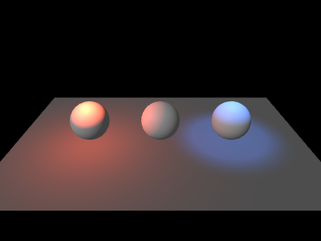
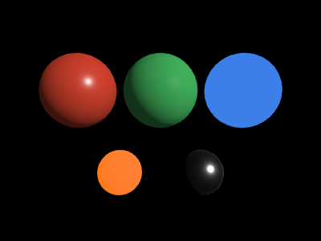
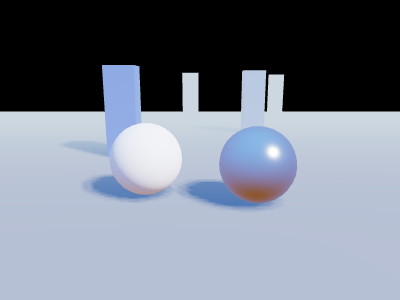

# Lights and materials

@pixi/3d's lights and materials are elements like any node or geometry. A lit material shows the light that reaches it; an unlit one shows its colour as it is.

## Lights

Four kinds, each a node that lights every lit mesh in the scene, wherever in the tree it is:

<!-- snippet: examples/3d/lights.example.tsx#lights -->

```tsx
<ambientLight3D intensity={0.15} />
<directionalLight3D angle={[-50, -30, 0]} intensity={0.8} />
<pointLight3D position={[-2.2, 1.2, 0.5]} color="#ff5a36" intensity={12} range={6} />
<spotLight3D
  position={[2.2, 3, 0]}
  angle={[-90, 0, 0]}
  color="#4f86f7"
  intensity={40}
  coneAngle={30}
  penumbra={0.4}
  range={8}
/>
```



- `<ambientLight3D>` lights every surface the same, from no direction.
- `<directionalLight3D>` shines one way, like the sun, along its own -Z: turn it with `angle` or `rotation` to aim it. Its position doesn't matter.
- `<pointLight3D>` shines every way from its position, like a bulb, dimming with the square of the distance.
- `<spotLight3D>` is a cone from its position along its -Z; `coneAngle` is the angle from the centre to the edge in degrees, and `penumbra`, from 0 to 1, softens the edge.

Each has a `color`, any colour pixi takes, and an `intensity`. With no tone curve, which is @pixi/3d's default, a white surface facing a directional light of intensity 1 shows mid grey, and about 3 brings it to white. Point and spot lights dim with distance, so they need more. Give them a `range`, the smallest that looks right: the light fades to nothing there, and the view skips it where it can't reach. Setting `visible={false}` on a light, or on a parent, switches it off.

Shadows are @pixi/3d's own and need no setting on the root: a light with `castShadow` casts them, from each mesh with `castShadow` onto each with `receiveShadow`, and a light's `shadow` options in its `args` (`args={[{ castShadow: true, shadow: { bias: 0.002, cascades: 3 } }]}`) tune them. How soft their edges are, the tone curve, fog and the light around the scene are the root's settings, under [Tone mapping, fog and environment](#tone-mapping-fog-and-environment).

## Materials

<!-- snippet: examples/3d/materials.example.tsx#materials -->

```tsx
<mesh3D position={[-2.2, 0.8, 0]}>
  <sphereGeometry3D />
  <material3D baseColor="#d0402b" roughness={0.3} metallic={0} />
</mesh3D>
<mesh3D position={[0, 0.8, 0]}>
  <sphereGeometry3D />
  <phongMaterial3D baseColor="#3fae5a" shininess={80} specularStrength={1} />
</mesh3D>
<mesh3D position={[2.2, 0.8, 0]}>
  <sphereGeometry3D />
  <flatMaterial3D baseColor="#3d7fe8" />
</mesh3D>
```

- `<material3D>` is physically based: `baseColor`, `roughness` from smooth to rough, and `metallic` from 0 to 1. It is the one to reach for when a scene is lit for realism, and it takes the most features: emissive, clearcoat, sheen, transmission, iridescence and more, set in `args` since they shape its shader.
- `<phongMaterial3D>` is the classic lit material: a `baseColor` with a highlight set by `shininess`, `specularStrength` and `specularColor`. It is cheaper than `<material3D>`.
- `<flatMaterial3D>` is unlit: it shows `baseColor`, or its texture, as it is, whatever the lights do. Use it for UI in the 3D, sprites and anything already lit.

Every material has a base colour texture (`textures-baseColor`), `alpha` and `alphaMode` for transparency, and `doubleSided`.

<!-- snippet: examples/3d/materials.example.tsx#features -->

```tsx
<mesh3D position={[-1.1, -1.4, 0]} scale={0.6}>
  <sphereGeometry3D />
  <material3D args={[{ emissive: { color: '#ff7a1a', strength: 1 } }]} baseColor="#222222" metallic={0} />
</mesh3D>
<mesh3D position={[1.1, -1.4, 0]} scale={0.6}>
  <sphereGeometry3D />
  <material3D baseColor="#c0c0c0" roughness={0.2} metallic={1} />
</mesh3D>
```



The emissive sphere glows whatever lights it. The metal one is dark but for the light's highlight: metal shows what it reflects, and this scene has no environment around it to reflect.

## Tone mapping, fog and environment

A root draws with @pixi/3d's defaults: no tone curve, an exposure of 1, soft `'pcf'` shadow edges, no fog and no environment. The renderer's `toneMapping`, `exposure` and `shadowFilter` change how every view draws, and the scene's `fog` and `environment` how its own view draws, each under @pixi/3d's names and with its values. Set them as `<Canvas>`'s `renderer` and `scene` props:

<!-- snippet: examples/3d/environment.example.tsx#settings -->

```tsx
const fog: Fog = { type: 'linear', color: '#a8c0d8', near: 5, far: 22 };
const sky: Hemisphere = { skyColor: '#5d9cff', groundColor: '#7a4f24' };
```

<!-- snippet: examples/3d/environment.example.tsx#canvas -->

```tsx
export function App() {
  return (
    <Canvas
      camera={{ position: [0, 1.5, 7] }}
      renderer={{ toneMapping: 'aces', exposure: 1.4 }}
      scene={{ fog, environment: sky }}
    >
      <Stage />
    </Canvas>
  );
}
```



- `toneMapping` is the curve every view ends with. Under `'none'` light past full brightness clips to flat colour; `'aces'`, `'reinhard'` and `'uncharted2'` roll it off, as the white sphere's lit side here; `'custom'` leaves linear light for a post effect that maps it itself. A change recompiles the materials, so don't change it every frame.
- `exposure` brightens or darkens everything before the curve, and is free to change every frame.
- `shadowFilter` is how soft shadow edges are: `'hard'`, `'pcf'` or `'pcf-high'`.
- `fog` fades what is far into its `color`: `'linear'` fog from `near` to `far`, `'exponential'` and `'exp2'` fog by `density`. The view keeps the object, so changing its `color`, `near`, `far` or `density` is free.
- `environment` lights every lit surface from around the scene and is what metal reflects: a `Hemisphere`, sky colour above and ground colour below, or a `CubeTexture` for image-based light.

They can change while the scene runs. `state.renderer` and `state.scene`, from `useThree` or `useFrame`, hold them, and every view takes them before it draws, a view the renderer makes again after freeing an idle one included:

<!-- snippet: examples/3d/environment.example.tsx#runtime -->

```tsx
function Haze() {
  useFrame(({ renderer, elapsed }) => {
    renderer.exposure = 1.4 + 0.2 * Math.sin(elapsed);
    fog.far = 22 + 8 * Math.sin(elapsed / 2);
  });
  return null;
}
```

A portal's scene and a `<View3D>`'s have a `fog` and an `environment` of their own, which `attach` sets from inside (`<primitive object={fog} attach="fog" />`); the renderer's settings apply to their views too. With threejs-compat installed, the renderer draws with three's settings instead ([Canvas](../../../threejs-compat/src/__docs__/canvas.md)): `toneMapping` takes three's constants, and `toneMappingExposure`, `outputColorSpace` and `shadows` take the place of `exposure` and `shadowFilter`.
