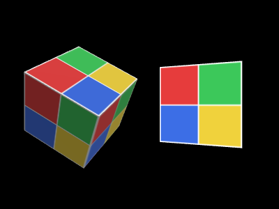

# Loading

Files load through react-three-fiber's `useLoader` and Suspense, with pixi's `Assets` doing the loading. `useAsset` from `@react-fiber/core` is `useLoader` with core's `AssetsLoader`: it suspends the component until pixi has loaded and parsed the file, and returns what pixi made of it. @pixi/3d registers its loaders with `Assets`, so a glTF file loads as a `Scene3DSource` and an image as a texture.

## Models

`<model3D>` builds a model from a loaded glTF file, which it takes as `args`:

<!-- snippet: examples/3d/loading.example.tsx#model -->

```tsx
function Crate() {
  const source = useAsset<Scene3DSource>('/models/textured-box.glb');

  return <model3D args={[source]} position={[-1.3, 0, 0]} angle={[25, 35, 0]} />;
}
```

A model is a node, so it takes a node's props and events, and its meshes, materials and animations are @pixi/3d's. A source loads once per URL and is shared: two `<model3D>` elements of one source are two models of one file.

## Textures

An image loads as a pixi `Texture`, which a material takes as its base colour texture:

<!-- snippet: examples/3d/loading.example.tsx#texture -->

```tsx
function Poster() {
  const texture = useAsset<Texture>('/textures/quadrants.png');

  return (
    <mesh3D position={[1.3, 0, 0]} angle={[0, -25, 0]}>
      <planeGeometry3D args={[{ width: 1.8, height: 1.8, flipV: true }]} />
      <flatMaterial3D textures-baseColor={texture} />
    </mesh3D>
  );
}
```

A plane that shows a picture takes `flipV`, as @pixi/3d asks, or the picture is upside down.

## Suspense

A component that loads suspends until its file is ready, so wrap it in React's `<Suspense>`, whose `fallback` shows meanwhile:

<!-- snippet: examples/3d/loading.example.tsx#suspense -->

```tsx
export function App() {
  return (
    <Canvas>
      <Lights />
      <Suspense fallback={null}>
        <Crate />
        <Poster />
      </Suspense>
    </Canvas>
  );
}
```



`useLoader.preload(AssetsLoader, url)` starts a load before anything renders, and `useLoader.clear(AssetsLoader, url)` forgets one. An error while loading is thrown at the component, for an error boundary to catch. The same hooks load spritesheets, fonts and anything else pixi's `Assets` loads, as [Loading 2D assets](../../../2d/src/__docs__/loading-2d.md) shows.
