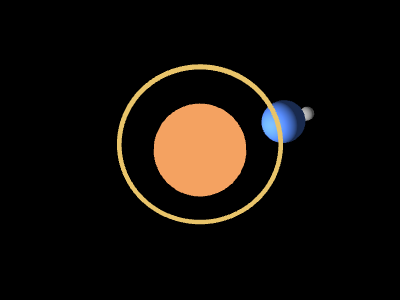

# Objects

`@react-fiber/3d` puts @pixi/3d's own classes in the tree as elements. The classes are @pixi/3d's as they are, not subclasses, and stay as @pixi/3d made them: nothing of three's is installed or bundled, and a ref gets the @pixi/3d object.

## Names

Each element is its class's name in camelCase with a `3D` suffix, once: a name that already ends in `3D` keeps it.

| Kind       | Elements                                                                                                                                                                                                                  |
| ---------- | ------------------------------------------------------------------------------------------------------------------------------------------------------------------------------------------------------------------------- |
| Nodes      | `<container3D>`, `<mesh3D>`, `<model3D>`, `<sprite3D>`, `<batchedMesh3D>`, `<particleContainer3D>`, `<camera3D>`                                                                                                          |
| Lights     | `<ambientLight3D>`, `<directionalLight3D>`, `<pointLight3D>`, `<spotLight3D>`                                                                                                                                             |
| Geometries | `<geometry3D>`, `<cubeGeometry3D>`, `<sphereGeometry3D>`, `<planeGeometry3D>`, `<cylinderGeometry3D>`, `<coneGeometry3D>`, `<capsuleGeometry3D>`, `<torusGeometry3D>`, `<torusKnotGeometry3D>`, `<icosahedronGeometry3D>` |
| Materials  | `<material3D>` (physically based), `<phongMaterial3D>`, `<flatMaterial3D>` (unlit), `<particleMaterial3D>`                                                                                                                |

@pixi/3d's `View3D` has no element: a root draws its scene through a view of its own, and `<View3D>` from `@react-fiber/core` draws a scene inside 2D ([Mixing 2D and 3D](../../../core/src/__docs__/mixing-2d-and-3d.md)).

## Nesting

Nodes nest as @pixi/3d's containers do: a child's `position`, rotation and scale are in its parent's space, so it moves with the parent. A `<container3D>` groups nodes, and a mesh holds children too:

<!-- snippet: examples/3d/objects.example.tsx#nesting -->

```tsx
function Planet() {
  const orbit = useRef<Container3D>(null);

  useFrame((_, delta) => {
    orbit.current!.rotation.y += delta;
  });

  return (
    <container3D ref={orbit}>
      <mesh3D position={[2.2, 0, 0]} scale={0.45}>
        <sphereGeometry3D />
        <material3D baseColor="#4f86f7" roughness={0.7} />
        <mesh3D position={[1.8, 0, 0]} scale={0.35}>
          <sphereGeometry3D />
          <material3D baseColor="#d9d9d9" roughness={0.9} />
        </mesh3D>
      </mesh3D>
    </container3D>
  );
}
```

Elements are added in the order they are written, and an element React inserts between two others goes between them, through @pixi/3d's `addChildAt`. Geometries and materials don't join the children: they attach to their mesh's `geometry` and `material`. A 3D element can't be a child of a 2D one; it is left out with a warning, and `<View3D>` draws 3D inside 2D instead.

## Objects you made

`<primitive object={...}>` puts an object you made into the tree, with the props of its element:

<!-- snippet: examples/3d/objects.example.tsx#primitive -->

```tsx
function Ring() {
  const ring = useMemo(
    () =>
      new Mesh3D({
        geometry: new TorusGeometry({ radius: 1.4, tube: 0.04, tubularSegments: 96 }),
        material: new FlatMaterial({ baseColor: '#e9c46a' }),
      }),
    [],
  );

  useEffect(() => () => ring.destroy({ children: true }), [ring]);

  return <primitive object={ring} angle={[80, 0, 0]} />;
}
```



A primitive is never freed when it unmounts, since it is yours: free it yourself, as the effect does here. A model that `<model3D>` builds from a loaded file is the element's, and freed with it.

## Refs

A ref gets the object behind the element, typed with its class from `@pixi/3d`: `useRef<Mesh3D>(null)`, `useRef<Container3D>(null)`. The one exception is `<camera3D>`, which is core's `RootCamera`: @pixi/3d's `Camera3D` with the members react-three-fiber's core calls on a camera, so a camera element can become the root's camera through `useThree((state) => state.set)({ camera })`, or a `<View3D>`'s.

## Your own classes

A class of your own, such as a subclass of `Mesh3D`, becomes an element through react-three-fiber's `extend`, named as you register it:

```tsx
import { Mesh3D } from '@pixi/3d';
import { extend } from '@react-fiber/core';

class Crystal3D extends Mesh3D {}

extend({ Crystal3D });
```

Then `<crystal3D>` takes the class's constructor arguments as `args` and its fields as props.

## Freeing

Unmounting an element frees its object, as react-three-fiber disposes three's: a node, a geometry and a material are destroyed with @pixi/3d's `destroy()`, at idle time after the commit. `dispose={null}` on an element keeps its object, and a primitive is never freed.
