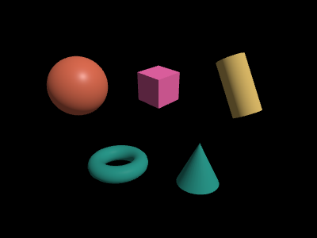

# Props, args and attach

@pixi/3d's elements take react-three-fiber's `args`, props and `attach`, filled with @pixi/3d's own values: its constructors' options objects, its fields and its vectors, and pixi's colours.



## Args

`args` are the constructor's arguments, which for @pixi/3d's classes is one options object, the one its docs list:

<!-- snippet: examples/3d/props.example.tsx#args -->

```tsx
<mesh3D position={[-2.2, 0.9, 0]}>
  <sphereGeometry3D args={[{ radius: 0.8, widthSegments: 48, heightSegments: 24 }]} />
  <material3D baseColor="#e76f51" roughness={0.4} />
</mesh3D>
```

New `args` build a new object, as in react-three-fiber. A geometry has no props that change its shape after it is built, so its options go in `args`; a material can take a feature in `args` that it can't turn on later, such as `<material3D args={[{ emissive: { color: '#ff7a1a', strength: 1 } }]} />`.

## Props

A prop sets the field of the same name, and takes what its setter takes, which is what the constructor's option of that name takes too:

<!-- snippet: examples/3d/props.example.tsx#props -->

```tsx
<mesh3D position={[0, 0.9, 0]} angle={[30, 45, 0]} scale={0.8}>
  <cubeGeometry3D />
  <material3D baseColor="hotpink" roughness={0.8} metallic={0} />
</mesh3D>
```

- **Vectors.** `position` and `scale` are @pixi/3d's `ObservableVector3`, which take `[x, y, z]` through `fromArray`, a single number for all three through `set`, or `{ x, y, z }`.
- **Rotation.** `rotation` is in radians and `angle` in degrees, each `[x, y, z]` in that order; `quaternion` takes `[x, y, z, w]`.
- **Colours.** `baseColor` and a light's `color` take any colour pixi takes: a name, a hex string or number, `[r, g, b]` from 0 to 1, or a pixi `Color`. They read back as @pixi/3d stores them.
- **Everything else** is the field as @pixi/3d has it: a material's `roughness`, `metallic` and `doubleSided`, a light's `intensity` and `range`, a node's `visible`, `eventMode` or `hitVolume`.

The element types follow the classes, so a misspelt prop or a value of the wrong kind is a type error.

## Piercing

A dash reaches into a field, as in react-three-fiber:

<!-- snippet: examples/3d/props.example.tsx#pierce -->

```tsx
<mesh3D position-x={2.2} position-y={0.9} scale-y={1.6} rotation-z={0.3}>
  <cylinderGeometry3D args={[{ radiusTop: 0.4, radiusBottom: 0.4, height: 1 }]} />
  <material3D baseColor="#e9c46a" />
</mesh3D>
```

`textures-baseColor={texture}` sets a material's base colour texture the same way, through @pixi/3d's texture slots.

## Attach

A geometry or a material attaches to its parent mesh's `geometry` or `material` without saying so. `attach` names another field, or attaches an object you made, such as a material two meshes share:

<!-- snippet: examples/3d/props.example.tsx#attach -->

```tsx
const shared = useMemo(() => new PhongMaterial({ baseColor: '#2a9d8f', shininess: 60 }), []);

useEffect(() => () => shared.destroy(), [shared]);

<mesh3D position={[-1.1, -1.2, 0]} angle={[20, 30, 0]}>
  <torusGeometry3D args={[{ radius: 0.6, tube: 0.22 }]} />
  <primitive object={shared} attach="material" />
</mesh3D>
<mesh3D position={[1.1, -1.2, 0]} angle={[20, -30, 0]}>
  <coneGeometry3D args={[{ radius: 0.6, height: 1.2 }]} />
  <primitive object={shared} attach="material" />
</mesh3D>
```

When the element unmounts, its parent's field goes back to what it was: @pixi/3d's empty geometry or material, until another attaches. `attach` also takes a function, `(parent, self) => detach`, for a field that isn't set by assignment.

## Aiming lights and cameras

Lights and cameras face their own -Z, as @pixi/3d's do, so a directional or spot light is aimed by turning it: `angle={[-90, 0, 0]}` points it straight down. To aim at a point, call @pixi/3d's `lookAt` on a ref, which turns the node to face it.
