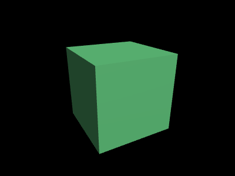

# Your first 3D scene

This builds a lit, turning cube with `@react-fiber/3d`, whose elements are @pixi/3d's own classes: options objects as `args`, @pixi/3d's fields as props, and pixi's colours. The React side is react-three-fiber's, so `<Canvas>`, `useFrame` and the events work as they do there.

## Setting up the Canvas

Install the packages, as [Installation](../../../core/src/__docs__/installation.md) shows, and import `@react-fiber/3d` once, which installs its elements. `<Canvas>` fills its parent, so give the parent a size:

```css
#canvas-container {
  width: 100vw;
  height: 100vh;
}
```

The whole scene:

<!-- snippet: examples/3d/first-3d-scene.example.tsx#result -->

```tsx
import type { Mesh3D } from '@pixi/3d';
import { Canvas, useFrame } from '@react-fiber/core';
import '@react-fiber/3d';
import { useRef } from 'react';

function Box() {
  const mesh = useRef<Mesh3D>(null);

  useFrame((_, delta) => {
    mesh.current!.rotation.y += delta;
  });

  return (
    <mesh3D ref={mesh} rotation-x={0.4}>
      <cubeGeometry3D args={[{ width: 2, height: 2, depth: 2 }]} />
      <material3D baseColor="#5ec27a" roughness={0.6} />
    </mesh3D>
  );
}

function Scene() {
  return (
    <>
      <ambientLight3D intensity={0.3} />
      <directionalLight3D angle={[-35, 30, 0]} intensity={3} />
      <Box />
    </>
  );
}

export function App() {
  return (
    <div id="canvas-container">
      <Canvas>
        <Scene />
      </Canvas>
    </div>
  );
}
```



## A mesh

A `<mesh3D>` is @pixi/3d's `Mesh3D`: a node that draws a geometry with a material. Its children `<cubeGeometry3D>` and `<material3D>` attach to it as its `geometry` and `material`, so the JSX reads as the scene graph does:

<!-- snippet: examples/3d/first-3d-scene.example.tsx#box -->

```tsx
function Box() {
  const mesh = useRef<Mesh3D>(null);

  useFrame((_, delta) => {
    mesh.current!.rotation.y += delta;
  });

  return (
    <mesh3D ref={mesh} rotation-x={0.4}>
      <cubeGeometry3D args={[{ width: 2, height: 2, depth: 2 }]} />
      <material3D baseColor="#5ec27a" roughness={0.6} />
    </mesh3D>
  );
}
```

- `args` are the constructor's arguments. @pixi/3d's classes take one options object, so `args={[{ width: 2, height: 2, depth: 2 }]}` is `new CubeGeometry({ width: 2, height: 2, depth: 2 })`.
- Props set fields. `baseColor` takes any colour pixi takes, and `roughness` is the material's own field. `rotation-x={0.4}` writes `rotation.x`, in radians; `angle` is the same rotation in degrees.
- `ref` gets the `Mesh3D` itself, typed from `@pixi/3d`.
- `useFrame` runs before every frame with the seconds since the last one, so the cube turns a radian a second at any frame rate.

## Lights

`<material3D>` is @pixi/3d's physically based material, so it needs light to show:

<!-- snippet: examples/3d/first-3d-scene.example.tsx#lights -->

```tsx
function Scene() {
  return (
    <>
      <ambientLight3D intensity={0.3} />
      <directionalLight3D angle={[-35, 30, 0]} intensity={3} />
      <Box />
    </>
  );
}
```

An ambient light lights every face the same; a directional light shines from one direction, along its own -Z, so it is aimed by turning it with `angle`. [Lights and materials](lights-and-materials-3d.md) has the rest.

## The camera

The root's camera is a @pixi/3d `Camera3D` with a field of view of 50 at z 5, looking at the origin, react-three-fiber's default. `<Canvas camera={{ position: [0, 2, 6], fov: 40 }}>` sets it, and [Canvas and roots](../../../core/src/__docs__/canvas-and-roots.md) covers the rest of a root.

## Where next

- [Objects](objects-3d.md) lists the elements and how they nest.
- [Props, args and attach](props-3d.md) covers what elements take.
- [Events](events-3d.md) and [Loading](loading-3d.md) add the pointer and files.
- 2D draws in the same canvas once `@react-fiber/2d` is imported: [Your first 2D scene](../../../2d/src/__docs__/your-first-2d-scene.md).
