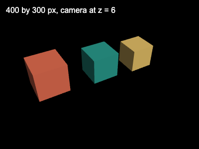

# Canvas and roots

`<Canvas>` from `@react-fiber/core` is react-three-fiber's `<Canvas>`: it fills its parent element, measures it, and renders its children into a root that pixi.js draws. Its children are elements of whichever packages are installed, 2D and 3D alike, and hooks such as `useFrame` and `useThree` work anywhere inside it.

<!-- snippet: examples/core/canvas.example.tsx#canvas -->

```tsx
export function App() {
  return (
    <Canvas camera={{ position: [0, 2, 6], fov: 40 }} renderer={{ preference: 'webgpu' }} dpr={[1, 2]}>
      <Scene />
    </Canvas>
  );
}
```



## Properties

The props are react-three-fiber's, with pixi's renderer behind them:

| Prop              | What it does                                                                                                                                                                                                                                                                                                                            |
| ----------------- | --------------------------------------------------------------------------------------------------------------------------------------------------------------------------------------------------------------------------------------------------------------------------------------------------------------------------------------- |
| `renderer`        | pixi's renderer options: `preference` (`'webgl'` by default, or `'webgpu'`, which falls back to WebGL where the browser has no WebGPU), `antialias` (on by default), `alpha` (a transparent canvas, on by default), `powerPreference` and `useBackBuffer`. `gl` is the same prop, so code written for `@react-three/fiber/legacy` runs. |
| `camera`          | Props for the default camera, such as `position`, `fov`, `near`, `far` and `zoom`, or a camera of your own.                                                                                                                                                                                                                             |
| `orthographic`    | Makes the default camera orthographic, `zoom` pixels to a unit.                                                                                                                                                                                                                                                                         |
| `scene`           | Props for the default scene, or a scene of your own.                                                                                                                                                                                                                                                                                    |
| `frameloop`       | `'always'` (the default), `'demand'` or `'never'`; [The frame loop](frame-loop.md) covers them.                                                                                                                                                                                                                                         |
| `dpr`             | The pixel ratio, or a range the device's is clamped to, `[1, 2]` by default.                                                                                                                                                                                                                                                            |
| `events`          | The event layer, `events` from this package by default.                                                                                                                                                                                                                                                                                 |
| `onCreated`       | Called with the root's state once it is set up, before the first frame.                                                                                                                                                                                                                                                                 |
| `onPointerMissed` | A click that hit nothing.                                                                                                                                                                                                                                                                                                               |

`shadows` and the renderer's `toneMapping`, `toneMappingExposure` and `outputColorSpace` are react-three-fiber's settings for three's renderer: threejs-compat's renderer draws with them, and without it they are kept and unused, and @pixi/3d draws with its own defaults, no tone curve and an sRGB output. `primary` and `share` are ignored: pixi.js can't draw one renderer into several canvases, so every canvas has its own.

## What a root holds

`useThree` reads the root's state, as in react-three-fiber:

<!-- snippet: examples/core/canvas.example.tsx#state -->

```tsx
function Readout() {
  const size = useThree((state) => state.size);
  const camera = useThree((state) => state.camera);

  return (
    <text2D
      text={`${size.width} by ${size.height} px, camera at z = ${camera.position.z}`}
      x={12}
      y={12}
      style={{ fill: 'white', fontSize: 16, fontFamily: 'Arial' }}
    />
  );
}
```

- `scene` is the root's scene, a @pixi/3d `Container3D` (`RootScene`) that 3D elements join.
- `camera` is a @pixi/3d `Camera3D` (`RootPerspectiveCamera`, or `RootOrthographicCamera` with `orthographic`), with a field of view of 50 at z 5, looking at the origin.
- `raycaster` picks 3D for the events with @pixi/3d's hit volumes (`RootRaycaster`).
- `renderer` is core's `PixiRenderer`, which holds the pixi.js renderer as `renderer.pixi`.
- `screen` is the root's screen layer, the pixi.js container its 2D draws in ([The stage](screen-layer.md)).
- `size`, `viewport`, `pointer`, `frameloop`, `invalidate`, `advance`, `set` and `get` are react-three-fiber's.

These classes are core's, exported from `@react-fiber/core` as `RootScene`, `RootPerspectiveCamera`, `RootOrthographicCamera`, `RootRaycaster`, `RootVector3` and `RootFrustum`: @pixi/3d's classes with the members react-three-fiber's core calls on a scene, a camera or a raycaster. With threejs-compat installed, a root gets three's classes instead.

## Roots without React DOM

`createRoot` makes a root on a canvas of your own, as react-three-fiber's does, for an app that manages its canvas or doesn't use React DOM:

```tsx
import { createRoot, events } from '@react-fiber/core';
import '@react-fiber/3d';

const root = createRoot(document.querySelector('canvas')!);

await root.configure({ events, camera: { position: [0, 0, 5] }, size: { width: 800, height: 600, top: 0, left: 0 } });
root.render(<mesh3D />);
```

`configure` takes `<Canvas>`'s props, and the first call creates the renderer, which pixi.js sets up asynchronously, so await it before the first `render`. `unmount()` frees the tree and the renderer.
