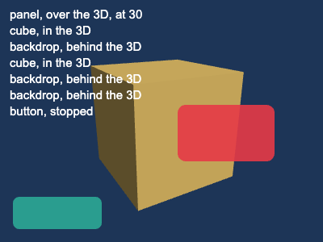

# Events across 2D and 3D

There is one event system, react-three-fiber's, for 2D and 3D alike. A 2D element or a 3D object takes the same handlers (`onClick`, `onPointerOver`, `onPointerMove`, `onPointerDown`, `onWheel`, `onPointerMissed`, ...), and one pointer event reaches everything under the pointer, front to back, until a handler stops it. pixi's own event system stays off: no pixi listener runs and pixi never sets the cursor.

## What is hit first

Hits are ordered by where they are drawn, as the stage draws them: 2D over the 3D first, front to back; then the 3D, nearest first; then 2D behind the 3D. A click where a 2D panel covers a cube reaches the panel, then the cube, then the backdrop behind them both:

<!-- snippet: examples/core/events.example.tsx#order -->

```tsx
<graphics2D
  zIndex={-1}
  draw={(graphics) => graphics.rect(0, 0, width, height).fill('#1d3557')}
  onClick={() => add('backdrop, behind the 3D')}
/>
<mesh3D angle={[20, 30, 0]} onClick={() => add('cube, in the 3D')}>
  <cubeGeometry3D args={[{ width: 2, height: 2, depth: 2 }]} />
  <phongMaterial3D baseColor="#e9c46a" />
</mesh3D>
<container2D
  x={width / 2 + 20}
  y={height / 2 - 20}
  onClick={(event: ThreeEvent2D<MouseEvent>) => add(`panel, over the 3D, at ${Math.round(event.local.x)}`)}
>
  <graphics2D draw={(graphics) => graphics.roundRect(0, 0, 120, 70, 10).fill({ color: '#e63946', alpha: 0.9 })} />
</container2D>
```

`stopPropagation()` ends the event where it is, so nothing behind gets it:

<!-- snippet: examples/core/events.example.tsx#stop -->

```tsx
<container2D x={16} y={height - 56}>
  <graphics2D
    draw={(graphics) => graphics.roundRect(0, 0, 110, 40, 8).fill('#2a9d8f')}
    onClick={(event: ThreeEvent2D<MouseEvent>) => {
      event.stopPropagation();
      add('button, stopped');
    }}
  />
</container2D>
```



Within each kind, the order is the one the package gives:

- **2D** is hit tested as pixi.js does it, front to back, with `eventMode`, `hitArea`, masks, `interactiveChildren`, `visible` and `renderable`. A handler alone makes an element interactive. [2D events](../../../2d/src/__docs__/events-2d.md) has the details.
- **3D** is picked along a ray from the camera: with @pixi/3d, by each node's `hitVolume` ([Events in 3D](../../../3d/src/__docs__/events-3d.md)); with threejs-compat, by three's raycaster.
- **Bridges** sort where they are drawn: the 3D inside a `<View3D>` is hit at the view's place among the 2D, before the view's own container, and the 2D in a `<RenderTexture2D>` just before the 3D object that shows it ([Mixing 2D and 3D](mixing-2d-and-3d.md)).

## Bubbling

After the hits are sorted, each one bubbles from the object up its parents, as in react-three-fiber: a click on a 2D button inside a 2D panel reaches the button's handler, then the panel's. 2D bubbles up the 2D and 3D up the 3D; a 2D element anchored to a 3D object bubbles up its 2D, not into the 3D object it follows. A `<View3D>`'s hits bubble out of the view into its 2D container.

## The event

A handler gets react-three-fiber's event, with the hit's fields on it:

- 3D: `object`, `eventObject`, `point`, `distance` and, with @pixi/3d's hits, `localPoint`, `normal`, `uv` and `triangleIndex`.
- 2D (`ThreeEvent2D`): `object`, `eventObject`, `global` (the pointer in the canvas's CSS pixels), `local` (the pointer in the element's own space), `getLocalPosition(container)` and a `distance` of 0.

Both have `stopPropagation()`, `pointer`, `ray`, `camera`, `delta` (how far the pointer moved since the press), the DOM event as `nativeEvent`, and pointer capture through `target.setPointerCapture(pointerId)`.

## The cursor

`cursor` on a 2D element sets the canvas's cursor while the pointer is over it, the frontmost element's winning. A 3D object sets one through a handler, as in react-three-fiber: `onPointerOver={() => (document.body.style.cursor = 'pointer')}`.
