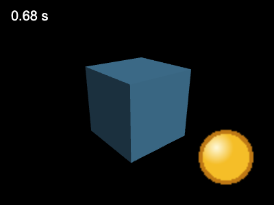

# The frame loop

Each root runs react-three-fiber's frame loop: every frame it runs the root's `useFrame` callbacks, then draws. 2D and 3D share it, so a sprite and a mesh changed in the same `useFrame` callback show in the same frame, and anything that animates on its own, such as an animated sprite, follows the same clock.

## useFrame

`useFrame(callback)` runs the callback before every frame is drawn, with the frame's state and the seconds since the last frame. Change objects through refs there, not through React state, so a frame costs no render:

<!-- snippet: examples/core/frame-loop.example.tsx#use-frame -->

```tsx
function Spinner() {
  const mesh = useRef<Mesh3D>(null);
  const label = useRef<Text>(null);

  useFrame(({ elapsed }, delta) => {
    mesh.current!.rotation.y += delta;
    label.current!.text = `${elapsed.toFixed(2)} s`;
  });

  return (
    <>
      <mesh3D ref={mesh} rotation-x={0.4}>
        <cubeGeometry3D args={[{ width: 1.6, height: 1.6, depth: 1.6 }]} />
        <phongMaterial3D baseColor="#457b9d" />
      </mesh3D>
      <text2D ref={label} x={16} y={12} style={{ fill: 'white', fontSize: 20, fontFamily: 'Arial' }} />
    </>
  );
}
```

The state is the root's, as `useThree` gives it, with `elapsed`, the seconds since the loop started. Callbacks run in phases, `update` by default; `useFrame(callback, { phase: 'physics' })` puts one in the fixed-step `physics` phase, and the scheduler `useFrame()` returns adds phases of your own. They are react-three-fiber's, and the [Canvas reference](../../../threejs-compat/src/__docs__/canvas.md#frame-loop) shows both.

## One clock

pixi.js runs its animated sprites on a shared ticker of its own. In a root, an `<animatedSprite2D>` runs on the root's clock instead, advanced before the app's `useFrame` callbacks, so it pauses with the loop, steps with `advance()`, and draws the same frame in a test as in the browser:

<!-- snippet: examples/core/frame-loop.example.tsx#clock -->

```tsx
function Coin() {
  const sheet = useAsset<Spritesheet>('/sprites/coin.json');

  return (
    <animatedSprite2D
      args={[sheet.animations.spin!]}
      animationSpeed={0.2}
      playing
      anchor={0.5}
      scale={2}
      x={330}
      y={230}
    />
  );
}
```



An animated sprite that sets `autoUpdate` keeps pixi's ticker instead.

## When frames are drawn

`frameloop` on the Canvas says when the loop runs:

- `'always'`, the default, draws every animation frame the browser gives, as long as the canvas is on screen.
- `'demand'` draws only when something asks: a prop change, which react-three-fiber turns into `invalidate()`, a playing animated sprite, or your own `invalidate()` after changing an object outside React. A still scene then costs nothing.
- `'never'` draws only when you call `advance(timestamp)`, for a loop you drive yourself, such as a test's fixed clock.

```tsx
const invalidate = useThree((state) => state.invalidate);
```

## Before and after the draw

The draw is the last job of a frame: the renderer places anchored 2D on the 3D it follows, culls 2D when pixi's `CullerPlugin` is registered, then pixi draws the stage. A `useFrame` callback therefore sees last frame's picture and sets this one's. Work that has to follow the camera, such as a label, goes in an `<anchor2D>` ([Mixing 2D and 3D](mixing-2d-and-3d.md)), which is placed after every callback ran.
