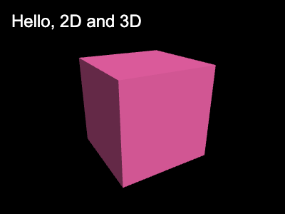

# Introduction

react-pixi-fiber is a set of React renderers for [pixi.js](https://pixijs.com) 2D and [@pixi/3d](https://github.com/pixijs/3d) with [react-three-fiber](https://r3f.docs.pmnd.rs)'s API: the same `<Canvas>`, hooks, events, `args`, props and `attach`, and Suspense for loading. The React side is react-three-fiber v10's own core; pixi.js and @pixi/3d draw what it builds. 2D and 3D are elements of one tree, in one canvas, with one event system.

<!-- snippet: examples/core/hello.example.tsx#result -->

```tsx
import type { Mesh3D } from '@pixi/3d';
import { Canvas, useFrame } from '@react-fiber/core';
import '@react-fiber/2d';
import '@react-fiber/3d';
import { useRef, useState } from 'react';

function Box() {
  const mesh = useRef<Mesh3D>(null);
  const [hovered, setHovered] = useState(false);

  useFrame((_, delta) => {
    mesh.current!.rotation.y += delta;
  });

  return (
    <mesh3D ref={mesh} rotation-x={0.4} onPointerOver={() => setHovered(true)} onPointerOut={() => setHovered(false)}>
      <cubeGeometry3D args={[{ width: 2, height: 2, depth: 2 }]} />
      <phongMaterial3D baseColor={hovered ? 'hotpink' : 'orange'} />
    </mesh3D>
  );
}

function Scene() {
  return (
    <>
      <ambientLight3D intensity={0.4} />
      <directionalLight3D angle={[-35, 30, 0]} intensity={2.5} />
      <Box />
      <text2D text="Hello, 2D and 3D" x={16} y={16} style={{ fill: 'white', fontSize: 24, fontFamily: 'Arial' }} />
    </>
  );
}

export function App() {
  return (
    <Canvas>
      <Scene />
    </Canvas>
  );
}
```



## The packages

Each package is installed and imported on its own, and the ones you import decide what the tree can hold:

| Package                       | What it is                                                                                                                                                   | Docs                                                                               |
| ----------------------------- | ------------------------------------------------------------------------------------------------------------------------------------------------------------ | ---------------------------------------------------------------------------------- |
| `@react-fiber/core`           | react-three-fiber's API on pixi.js: `<Canvas>`, `createRoot`, the hooks, the events, the stage that draws 2D over and under 3D, and the bridges between them | [Canvas and roots](canvas-and-roots.md)                                            |
| `@react-fiber/2d`             | pixi.js's 2D classes as elements: `<sprite2D>`, `<graphics2D>`, `<text2D>`, `<blurFilter2D attach="filters-0">`                                              | [Your first 2D scene](../../../2d/src/__docs__/your-first-2d-scene.md)             |
| `@react-fiber/3d`             | @pixi/3d's classes as elements, under pixi's conventions: `<mesh3D>`, `<sphereGeometry3D>`, `<phongMaterial3D>`, `<pointLight3D>`                            | [Your first 3D scene](../../../3d/src/__docs__/your-first-3d-scene.md)             |
| `@react-fiber/threejs-compat` | Optional: three.js's names and API over @pixi/3d (`<mesh>`, `<boxGeometry>`, `three`'s math and loaders), so a react-three-fiber app swaps its imports       | [Swap your three.js imports](../../../threejs-compat/src/__docs__/swap-imports.md) |
| `@react-fiber/r3f`            | react-three-fiber's `packages/fiber`, forked so its core asks the renderer through hooks; core bundles it                                                    | [Renderer hooks](../../../r3f/README.md)                                           |

They stack: `@react-fiber/r3f` under `@react-fiber/core`, and 2d, 3d and threejs-compat on core, each registering its elements when it is imported. threejs-compat builds on 3d, giving the same @pixi/3d objects three's names and members.

## Which to use

- **2D alone**: core and 2d. A canvas with no 3D in it makes no 3D view and costs a 2D renderer.
- **3D in pixi's terms**: core and 3d. Elements are @pixi/3d's classes, `args` are their options objects, and props their fields: `baseColor`, `angle`, `hitVolume`. Nothing of three.js is installed or bundled.
- **2D and 3D together**: core, 2d and 3d, as above. 2D draws over or behind the 3D, follows 3D objects, holds 3D views and draws onto 3D materials, through [the bridges](mixing-2d-and-3d.md).
- **An existing react-three-fiber app**: threejs-compat, which changes its imports and little else. 2D joins it the same way.

## How does it work?

react-three-fiber v10 splits its core from the renderer it drives. react-pixi-fiber keeps that core: the reconciler, the store, the frame loop, the event system, `<Canvas>` and the Suspense loaders are r3f's own code. It runs as a fork with one kind of change: where core reached into three.js objects (adding a child, writing a prop, casting a ray, ordering hits, freeing an object), it asks the renderer through eight hooks, which three's renderers answer as before. A script checks the fork's diff against r3f's repository, and r3f's own tests pass on it. [The r3f fork](../../../r3f/README.md) lists each hook and why it is there.

`@react-fiber/core` answers those hooks for pixi. It gives every root a renderer support that asks the package that owns each object: 2d for pixi.js's containers, filters and particles, 3d for @pixi/3d's nodes, geometries and materials. Packages register with core through pixi.js's `extensions`, as pixi plugins do. core also orders pointer hits across 2D and 3D by where they are drawn, and gives each root @pixi/3d's own scene, camera and raycaster.

## Where next

- [Installation](installation.md) sets up the packages you picked.
- [Canvas and roots](canvas-and-roots.md) covers `<Canvas>`, what a root holds and how to make one without React DOM.
- [Your first 2D scene](../../../2d/src/__docs__/your-first-2d-scene.md) and [Your first 3D scene](../../../3d/src/__docs__/your-first-3d-scene.md) start each kind of element.
- [Swap your three.js imports](../../../threejs-compat/src/__docs__/swap-imports.md) moves a react-three-fiber app over.
