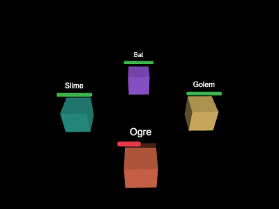
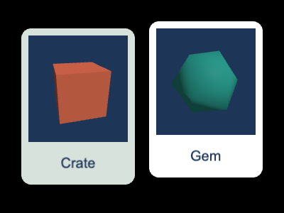
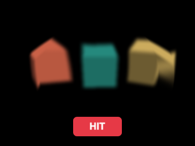
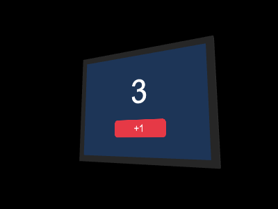

# Mixing 2D and 3D

2D and 3D share one canvas, one tree and one event system, and four bridges let each reach into the other: 2D that follows a 3D object, 3D inside 2D, the canvas's 3D as a 2D node, and 2D drawn into a material's texture. They are core's, and need `@react-fiber/2d` installed, since what they hold is 2D. They work with @pixi/3d's elements from `@react-fiber/3d`, as the examples here use, and with three's from threejs-compat.

| Bridge              | What it does                                                                                       |
| ------------------- | -------------------------------------------------------------------------------------------------- |
| `<anchor2D>`        | 2D that follows a 3D object on screen: labels, health bars, floating text, bursts at a hit point   |
| `<View3D>`          | 3D inside the 2D: a scene of its own drawn in a 2D container, which moves, fades and masks with it |
| `<Layer3D>`         | The canvas's 3D as a 2D node: move it, scale it, fade it, filter it, mask it                       |
| `<RenderTexture2D>` | 2D drawn into a texture, as the map of a 3D object's material, with pointer events through it      |

Each is drawn by pixi in the same pass as the rest of the canvas.

## 2D that follows 3D

Put an `<anchor2D>` inside a 3D object and its 2D children follow that object across the screen. The anchor is a pixi.js container whose position is worked out from the camera before every frame is drawn, after `useFrame` has moved the 3D, so the 2D is never a frame behind:

<!-- snippet: examples/core/anchored-labels.example.tsx#label -->

```tsx
function HealthBar({ name, health }: { name: string; health: number }) {
  return (
    <anchor2D point={[0, 0.7, 0]} center={[0.5, 1]} distanceFactor={4.5} sortByDepth>
      <text2D text={name} x={40} anchor={{ x: 0.5, y: 0 }} style={{ fill: 'white', fontSize: 16 }} />
      <graphics2D
        y={22}
        draw={(graphics) =>
          graphics
            .roundRect(0, 0, 80, 12, 4)
            .fill({ color: 'black', alpha: 0.6 })
            .roundRect(2, 2, 76 * health, 8, 3)
            .fill(health > 0.5 ? '#3cb44b' : '#e63946')
        }
      />
    </anchor2D>
  );
}
```



Its props, besides a container's:

- `point`: the point it follows, in the 3D object's own space. `[0, 0.7, 0]` is just above a box's centre.
- `target`: the 3D object to follow, or a ref to it, when the anchor isn't inside it. With neither, `point` is in world space.
- `center`: which point of the 2D's bounds sits on the point. `true` is the middle, `[0.5, 1]` the bottom middle, so a label stands on the point.
- `offset`: moves the 2D from where the point lands, in pixels, as `[0, -20]`. The anchor's own `x` and `y` are written every frame.
- `distanceFactor`: scales the 2D with distance from a perspective camera, or by an orthographic camera's `zoom`, as drei's `<Html distanceFactor>` does.
- `sortByDepth`: nearer anchors draw over farther ones.
- `occlude`: hides the 2D while a 3D object is between the camera and the point: `true` tests the whole scene, a list tests those objects. Each anchor that occludes casts a ray every frame, so give it a short list where you can.
- `hideOffscreen`: hides the 2D while the point is off the view.

The 2D is also hidden while the point is behind the camera and while the 3D object or one of its parents is invisible. `onScreen` says whether it was drawn on the last frame, and `depth` how far the point was from the camera.

A 2D element placed directly inside a 3D object gets an anchor of its own, which follows the object's origin:

```tsx
<mesh3D position={[1, 0, 0]}>
  <cubeGeometry3D />
  <phongMaterial3D />
  <sprite2D texture={Texture.WHITE} width={12} height={12} anchor={0.5} />
</mesh3D>
```

Anchors are drawn in the [3D layer](#the-3d-layer-as-a-2d-node), over the 3D and under 2D placed directly in the Canvas, and they move and filter with it. They take events as any 2D does, first among the 3D; their events bubble up the 2D, not into the 3D object they follow.

## 3D inside 2D

`<View3D>` draws a 3D scene of its own inside the 2D tree, so a model can sit in a 2D card and move, scale, turn and fade with it:

<!-- snippet: examples/core/model-cards.example.tsx#card -->

```tsx
function Card({ x, title, color, children }: { x: number; title: string; color: string; children: ReactNode }) {
  const [hovered, setHovered] = useState(false);

  return (
    <container2D
      x={x}
      y={hovered ? 30 : 40}
      cursor="pointer"
      onPointerOver={() => setHovered(true)}
      onPointerOut={() => setHovered(false)}
    >
      <graphics2D draw={(graphics) => graphics.roundRect(0, 0, 160, 220, 14).fill(hovered ? '#ffffff' : '#d8e2dc')} />
      <View3D x={10} y={10} width={140} height={150} camera={{ position: [0, 0, 3.4] }}>
        <primitive object={NAVY} attach="background" />
        <ambientLight3D intensity={0.4} />
        <directionalLight3D angle={[-35, 30, 0]} intensity={2.5} />
        <Turntable speed={hovered ? 3 : 0.5} color={color}>
          {children}
        </Turntable>
      </View3D>
      <text2D text={title} x={80} y={190} anchor={0.5} style={{ fill: '#1d3557', fontSize: 20 }} />
    </container2D>
  );
}
```



Its children are the view's scene, rendered through r3f's `createPortal`:

- `camera` takes a camera, or props for its own as `<Canvas camera>` does: a perspective camera with a fov of 50 at z 5, unless `orthographic`. Inside it, `useThree` gives that camera and the view's `size`, and `useFrame` runs as usual.
- The scene draws as a Canvas draws one, with its lights and a background, where a colour fills the view's rect: `<primitive object={new Color('#1d3557')} attach="background" />` with pixi's `Color`, or three's `<color attach="background">` with threejs-compat, which also brings three's tone mapping, shadows, fog and environment.
- 2D among its children draws on the view's own screen layer, over its 3D, or under it with a negative `zIndex`. `<anchor2D>` works inside it too.
- Its other props are those of the 2D container that holds the view (`x`, `y`, `scale`, `alpha`, handlers), and its `ref` gets that container. Its children go into the portal, so put filters and masks on a 2D container around it.
- Its `alpha`, or a parent's, fades its 3D with its 2D. Below 1 the 3D is drawn through an alpha filter of its own, one more pass while it is faded, and fades as one picture: its back faces don't show through its front ones.
- Events reach its 3D and 2D through its camera, at the place the view has in the 2D's draw order: 2D over the view is hit first, and a parent's mask or `hitArea` clips its hits. They bubble as a child's do: a click on a box in the view reaches the box, then the `<View3D>`'s own handlers, whose event's `object` is the container its `ref` gets, then the 2D around it, and a `stopPropagation` stops it there. A 3D hit inside it sorts by the view's place in the 2D's draw order, and keeps its `distance` and `point` along the ray, in the view's world.

Each `<View3D>` is a @pixi/3d view of its own, drawn in the canvas's pass with no extra canvas. It costs what a canvas's scene costs, so a handful on screen is cheap, and a grid of hundreds is better drawn as one scene. Unmounting frees the view.

## The 3D layer as a 2D node

The canvas's 3D is drawn in a pixi container, its 3D layer, which also holds the anchored 2D. `<Layer3D>` gives that layer a container's props, and its children attach to it: pixi's filters become post-processing on the 3D, and moving the layer shakes the screen:

<!-- snippet: examples/core/impact.example.tsx#impact -->

```tsx
function Impact() {
  const { width, height } = useThree((state) => state.size);
  const layer = useRef<Container>(null);
  const blur = useRef<BlurFilter>(null);
  const wave = useRef<DisplacementFilter>(null);
  const [ring, setRing] = useState<Sprite | null>(null);
  const texture = useMemo(() => ringTexture(), []);
  const hit = useRef({ pending: false, at: -Infinity });

  useEffect(() => () => texture.destroy(true), [texture]);

  useFrame(({ elapsed }) => {
    if (hit.current.pending) hit.current = { pending: false, at: elapsed };
    const age = elapsed - hit.current.at;
    const trauma = Math.max(0, 1 - age / 0.6);
    layer.current!.position.set(Math.sin(elapsed * 70) * 12 * trauma, Math.cos(elapsed * 55) * 8 * trauma);
    blur.current!.enabled = trauma > 0;
    blur.current!.strength = 4 * trauma;
    if (ring && wave.current) {
      ring.scale.set(0.4 + age * 5);
      wave.current.enabled = trauma > 0;
      wave.current.scale.set(35 * trauma);
    }
  });

  return (
    <>
      <Layer3D ref={layer}>
        <blurFilter2D ref={blur} attach="filters-0" strength={0} enabled={false} />
        {ring && <displacementFilter2D ref={wave} attach="filters-1" args={[{ sprite: ring, scale: 0 }]} />}
        <sprite2D ref={setRing} texture={texture} anchor={0.5} x={width / 2} y={height / 2} />
      </Layer3D>
      <container2D
        x={width / 2 - 50}
        y={height - 60}
        cursor="pointer"
        onClick={(event: ThreeEvent2D<MouseEvent>) => {
          event.stopPropagation();
          hit.current.pending = true;
        }}
      >
        <graphics2D draw={(graphics) => graphics.roundRect(0, 0, 100, 40, 8).fill('#e63946')} />
        <text2D text="HIT" x={50} y={20} anchor={0.5} style={{ fill: 'white', fontSize: 20, fontWeight: 'bold' }} />
      </container2D>
    </>
  );
}
```



- Filters attach as `filters-0`, `filters-1`, ...; a mask as `attach="mask"`. A 2D child, such as the displacement map's sprite, joins the layer.
- The 2D placed directly in the Canvas isn't in the layer, so a HUD stays sharp and still while the 3D shakes.
- Pointer events follow the layer's transform: scale the 3D into a corner as a minimap and its objects are picked where they are drawn. A mask on the layer doesn't clip 3D picking.
- `zIndex` places the 3D among the screen's 2D; it is just under 0 by default.
- `alpha` fades the 3D and the anchored 2D. The 3D fades as one picture, as a `<View3D>`'s does.
- `<Layer3D>` acts on the scene of the Canvas or portal it is in, wherever in the tree it is, so inside a `<View3D>` it filters that view's 3D. When it unmounts the layer goes back as it was.

## 2D in a texture

`<RenderTexture2D>` draws its 2D children into a texture and attaches the texture to the material it is in: as a @pixi/3d material's base colour texture (`textures.baseColor`), or as the `map` of a three material, unless `attach` says otherwise:

<!-- snippet: examples/core/screen-texture.example.tsx#screen -->

```tsx
function Monitor() {
  return (
    <container3D rotation={[-0.15, -0.45, 0]}>
      <mesh3D position={[0, 0, -0.08]}>
        <cubeGeometry3D args={[{ width: 3.3, height: 2.6, depth: 0.12 }]} />
        <phongMaterial3D baseColor="#333333" />
      </mesh3D>
      <mesh3D hitVolume="geometry">
        <planeGeometry3D args={[{ width: 3, height: 2.3, flipV: true }]} />
        <flatMaterial3D>
          <RenderTexture2D width={384} height={294}>
            <Counter />
          </RenderTexture2D>
        </flatMaterial3D>
      </mesh3D>
    </container3D>
  );
}
```

The 2D inside is laid out in the texture's pixels, and `useThree` gives the texture's size:

<!-- snippet: examples/core/screen-texture.example.tsx#ui -->

```tsx
function Counter() {
  const { width, height } = useThree((state) => state.size);
  const [count, setCount] = useState(0);

  return (
    <>
      <graphics2D draw={(graphics) => graphics.rect(0, 0, width, height).fill('#1d3557')} />
      <text2D text={`${count}`} x={width / 2} y={110} anchor={0.5} style={{ fill: 'white', fontSize: 96 }} />
      <container2D
        x={width / 2 - 80}
        y={190}
        cursor="pointer"
        onClick={(event: ThreeEvent2D<MouseEvent>) => {
          event.stopPropagation();
          setCount((value) => value + 1);
        }}
      >
        <graphics2D draw={(graphics) => graphics.roundRect(0, 0, 160, 50, 10).fill('#e63946')} />
        <text2D text="+1" x={80} y={25} anchor={0.5} style={{ fill: 'white', fontSize: 28 }} />
      </container2D>
    </>
  );
}
```



- It draws on every frame, before the canvas. `frames={1}` draws once, and again after each render of the component or a call to `invalidate()` on its `ref`, which also holds the `texture`.
- A `<flatMaterial3D>` shows the UI's colours as drawn. With threejs-compat, a material tone-maps its map, as three does, so a UI's colours shift under the default ACES curve; `toneMapped={false}` keeps them as drawn.
- Pointer events on the 3D object reach the 2D at the texture coordinates of the hit, as drei's `<RenderTexture>` forwards them, so a @pixi/3d mesh needs `hitVolume="geometry"`, which gives its hits a `uv`. They sort where the object was hit: 3D in front of it, or 2D over the canvas, is hit first. `global` on these events is in the texture's pixels. `compute` replaces how the pointer is found.
- Unmounting frees the texture.

## What they cost

A small check on an M3 Pro in headless Chromium: the median of five runs of 200 frames at 800 by 600 through `advance()`, and of frames whose GPU work was waited for. Other work was running on the machine, so read the numbers as rough:

| Scene                                         | CPU a frame, WebGL / WebGPU | With the GPU waited on, WebGL / WebGPU |
| --------------------------------------------- | --------------------------- | -------------------------------------- |
| 50 boxes                                      | 69 / 71 µs                  | 0.88 / 0.75 ms                         |
| 50 boxes with 50 `<anchor2D>` labels          | 66 / 117 µs                 | 0.94 / 0.81 ms                         |
| 6 boxes in the Canvas's scene                 | 70 / 125 µs                 | 0.91 / 0.79 ms                         |
| 6 `<View3D>`s with a box each                 | 135 / 249 µs                | 1.05 / 1.16 ms                         |
| A box, with a `<Layer3D>` blur                | 41 / 219 µs                 | 1.60 / 1.89 ms                         |
| A plane with a `<RenderTexture2D>` each frame | 45 / 73 µs                  | 0.79 / 0.90 ms                         |

Anchoring adds no cost the check could tell from noise. Six views cost about twice the CPU of the same boxes in one scene, a filter on the 3D layer costs what that filter costs on any 2D of the canvas's size, and a texture drawn each frame costs a 2D draw of its size. The per-frame code of the bridges reuses its own scratch objects and makes no new ones. An anchor's `occlude` raycast makes intersections only when something is in the way, as three's raycaster does.
