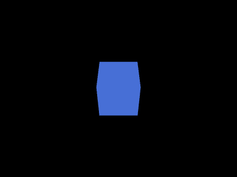
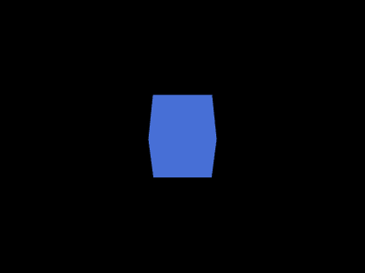
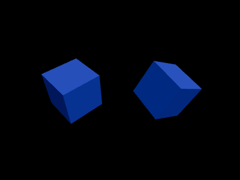

# Basic animations

This tutorial builds a small, continuous animation loop, the building block of more advanced animations. It uses refs and `useFrame`, exactly as in react-three-fiber.

## `useFrame`

`useFrame` runs a function on every frame of the render loop. Hooks like it can only be called inside a `<Canvas>`.

<!-- snippet: examples/basic-animations/every-frame.example.tsx#box -->

```tsx
import { useFrame } from '@react-fiber/threejs-compat';

function MyAnimatedBox() {
  useFrame(() => {
    console.log("I'm running every frame!");
  });

  return (
    <mesh>
      <boxGeometry />
      <meshBasicMaterial color="royalblue" />
    </mesh>
  );
}
```

The function gets the state of the scene. Its timing tells you how much time has passed, which is what animates a value:

```tsx
useFrame((state) => {
  console.log(state.elapsed); // about 0 on the first frame, growing every frame after
});
```

`state.elapsed` is the number of seconds since the first frame. `state.delta` is the time since the previous frame, `state.time` the timestamp of the frame, and `state.frame` the number of frames so far.

## Animating with refs

Going through React state for a value that changes every frame re-renders the component every frame. Mutate the object directly instead, through a ref:

<!-- snippet: examples/basic-animations/mesh-ref.example.tsx#box -->

```tsx
import type { Mesh } from '@react-fiber/threejs-compat/three';
import { useRef } from 'react';

function MyAnimatedBox() {
  const myMesh = useRef<Mesh>(null!);

  return (
    <mesh ref={myMesh}>
      <boxGeometry />
      <meshBasicMaterial color="royalblue" />
    </mesh>
  );
}
```

`myMesh.current` is the mesh, which `useFrame` can change without React. Its type comes from `@react-fiber/threejs-compat/three`, which has three's classes under three's names, as `three` does in an r3f app:

<!-- snippet: examples/basic-animations/rotating-box.example.tsx#frame -->

```tsx
useFrame((state) => {
  myMesh.current.rotation.x = state.elapsed;
});
```

- `elapsed` comes from the state `useFrame` passes.
- `myMesh.current.rotation.x` is the rotation of the mesh around its x axis.
- The angle grows with time, so the box turns around the x axis for as long as the scene runs.

Put together:

<!-- snippet: examples/basic-animations/rotating-box.example.tsx#result -->

```tsx
import { Canvas, useFrame } from '@react-fiber/threejs-compat';
import type { Mesh } from '@react-fiber/threejs-compat/three';
import { useRef } from 'react';

function MyAnimatedBox() {
  const myMesh = useRef<Mesh>(null!);

  useFrame((state) => {
    myMesh.current.rotation.x = state.elapsed;
  });

  return (
    <mesh ref={myMesh}>
      <boxGeometry />
      <meshBasicMaterial color="royalblue" />
    </mesh>
  );
}

export function App() {
  return (
    <Canvas>
      <MyAnimatedBox />
    </Canvas>
  );
}
```



**Try this:** set the rotation to `Math.sin(state.elapsed)` and watch the box swing back and forth:

<!-- snippet: examples/basic-animations/swinging-box.example.tsx#result -->

```tsx
import { Canvas, useFrame } from '@react-fiber/threejs-compat';
import type { Mesh } from '@react-fiber/threejs-compat/three';
import { useRef } from 'react';

function SwingingBox() {
  const myMesh = useRef<Mesh>(null!);

  useFrame((state) => {
    myMesh.current.rotation.x = Math.sin(state.elapsed);
  });

  return (
    <mesh ref={myMesh}>
      <boxGeometry />
      <meshBasicMaterial color="royalblue" />
    </mesh>
  );
}

export function App() {
  return (
    <Canvas>
      <SwingingBox />
    </Canvas>
  );
}
```



## Rotation order

A mesh's `rotation` is three's `Euler`: angles in radians about x, y and z, turned in the order its `order` names, `'XYZ'` unless you change it. The same angles in another order give another rotation, as in three. `rotation.set(x, y, z, order)` sets both, and `rotation` stays in step with `quaternion`, so either can drive the mesh:

<!-- snippet: examples/basic-animations/rotation-order.example.tsx#result -->

```tsx
import { Canvas, useFrame } from '@react-fiber/threejs-compat';
import type { Mesh } from '@react-fiber/threejs-compat/three';
import { useRef } from 'react';

function Tumbler({ position, order }: { position: [number, number, number]; order: 'XYZ' | 'YXZ' }) {
  const myMesh = useRef<Mesh>(null!);

  useFrame((state) => {
    myMesh.current.rotation.set(state.elapsed, state.elapsed, 0, order);
  });

  return (
    <mesh ref={myMesh} position={position}>
      <boxGeometry />
      <meshStandardMaterial color="royalblue" />
    </mesh>
  );
}

function Scene() {
  return (
    <>
      <ambientLight intensity={0.5} />
      <directionalLight position={[2, 3, 4]} intensity={1.5} />
      <Tumbler position={[-1.2, 0, 0]} order="XYZ" />
      <Tumbler position={[1.2, 0, 0]} order="YXZ" />
    </>
  );
}

export function App() {
  return (
    <Canvas>
      <Scene />
    </Canvas>
  );
}
```



## Frame loop modes

`<Canvas frameloop="demand">` draws only when something calls `invalidate()`, and `frameloop="never"` draws only when you call `advance()`. They work as in r3f, since the loop is r3f's own.

## Next steps

Now that the box moves, [make it respond to the pointer](events-and-interaction.md).
