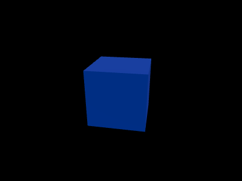
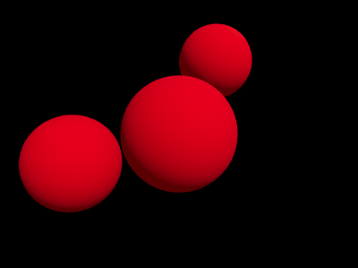
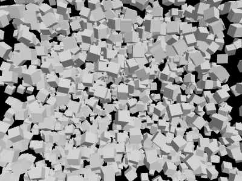
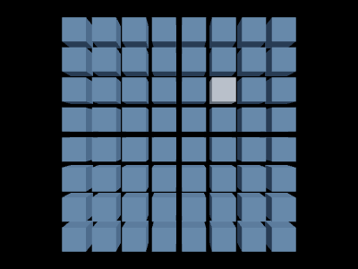

# Scaling performance

Rendering can be expensive, depending on the device, and an app that should run on a wide range of devices, the weaker ones included, has to look at what it costs. This page goes through the ways to keep a scene fast. Most are react-three-fiber's own, and work as r3f documents them; where pixi-3d does a thing differently from three.js, the page says how.

## On-demand rendering

Apps usually render in a loop that runs 60 times a second, and react-pixi-fiber does too. That is fine while something in the scene moves all the time, but it drains batteries and spins up fans. If the moving parts of a scene come to rest, rendering on demand draws only when something changed.

Set the canvas's `frameloop` to `demand`. It renders a frame whenever React changes a prop in the tree:

<!-- snippet: examples/scaling-performance/on-demand.example.tsx#demand -->

```tsx
<Canvas frameloop="demand">
```

### Triggering manual frames

When something changes an object behind React's back, as camera controls and refs do, React can't know, and the picture goes stale. Call `invalidate()` to ask for a frame:

<!-- snippet: examples/scaling-performance/on-demand.example.tsx#invalidate -->

```tsx
mesh.current.rotation.y += Math.PI / 4;
invalidate();
```



> [!IMPORTANT]
> `invalidate()` doesn't render at once: it asks for a frame. Calling it many times still renders one frame. Think of it as a flag that says something changed.

### Sync animations with on-demand rendering

Since `invalidate()` only schedules a frame, an animation that starts at once can be ahead by the time the first frame draws, and the picture jumps. Ask for the frame first, then start the animation on the next one:

```tsx
<mesh
  onClick={() => {
    invalidate();
    requestAnimationFrame(() => startAnimation());
  }}
/>
```

## Re-using geometries and materials

Each geometry and material costs the GPU memory and the renderer work. Re-use them when they repeat, for instance by making them once, outside the components:

<!-- snippet: examples/scaling-performance/reuse.example.tsx#shared -->

```tsx
const red = new MeshStandardMaterial({ color: 'red' });
const sphere = new SphereGeometry(1, 28, 28);

function Scene() {
  return (
    <>
      <mesh geometry={sphere} material={red} />
      <mesh position={[1, 2, -3]} geometry={sphere} material={red} />
```



`@react-fiber/threejs-compat/three`'s `Color` follows three's colour management, so a hex number or CSS colour given to a material made outside the canvas means the same as it does on an element. Unmounting a mesh doesn't dispose of a geometry or material it was given as a prop, so shared ones live on.

### Caching with `useLoader`

> [!NOTE]
> Everything loaded with `useLoader` is cached by its URL.

Loading the same URL anywhere in the tree gives back the same asset, so a model loaded in several components is one model in memory. [Loading models](loading-models.md) has more.

## Instancing

Each mesh is an object in the scene graph, with a transform, a place in culling and in picking, all of which cost time every frame. pixi-3d already draws meshes that share their pipeline in batches, so many meshes cost fewer draws than in three.js; the per-object cost stays. An `instancedMesh` draws many copies of one geometry and material as one object, as slots of pixi-3d's `BatchedMesh3D`, with no scene node per copy, so it scales to tens of thousands:

<!-- snippet: examples/scaling-performance/instancing.example.tsx#instances -->

```tsx
function Instances({ count = 2000, temp = new Object3D() }) {
  const instancedMeshRef = useRef<InstancedMesh>(null!);

  useEffect(() => {
    MathUtils.seededRandom(1);
    for (let i = 0; i < count; i++) {
      temp.position.set(MathUtils.seededRandom() - 0.5, MathUtils.seededRandom() - 0.5, MathUtils.seededRandom() - 0.5);
      temp.position.multiplyScalar(5);
      temp.rotation.set(MathUtils.seededRandom() * Math.PI, MathUtils.seededRandom() * Math.PI, 0);
      temp.updateMatrix();
      instancedMeshRef.current.setMatrixAt(i, temp.matrix);
    }
    instancedMeshRef.current.instanceMatrix.needsUpdate = true;
  }, [count, temp]);

  return (
    <instancedMesh ref={instancedMeshRef} args={[null, null, count]}>
      <boxGeometry args={[0.15, 0.15, 0.15]} />
      <meshStandardMaterial />
    </instancedMesh>
  );
}
```



`setMatrixAt` places an instance, `setColorAt` tints it, and `instanceMatrix.needsUpdate = true` sends values written straight into `instanceMatrix.array`. `count` draws fewer than the mesh was built for, and events carry the `instanceId` of the instance hit, so instances can be picked one by one:

<!-- snippet: examples/scaling-performance/instanced-hover.example.tsx#hover -->

```tsx
const paint = (id: number | undefined, lightness: number) => {
  if (id === undefined) return;
  mesh.current.setColorAt(id, color.setHSL(0.6, 0.5, lightness));
  mesh.current.instanceColor!.needsUpdate = true;
};

const onPointerMove = (e: ThreeEvent<PointerEvent>) => {
  e.stopPropagation();
  if (e.instanceId === hovered.current) return;
  paint(hovered.current, 0.35);
  paint((hovered.current = e.instanceId), 0.75);
};

const onPointerOut = () => {
  paint(hovered.current, 0.35);
  hovered.current = undefined;
};
```



What differs from three's `InstancedMesh`:

- `frustumCulled` culls each instance, on the GPU where WebGPU allows and on the CPU elsewhere, where three culls the whole mesh by its bounding sphere. It is on by default, as in three. Each instance costs CPU time on WebGL, so turn it off (`frustumCulled={false}`) for a batch that always fits in view.
- `setMatrixAt` and `setColorAt` reach the GPU without `needsUpdate`; it is only needed after writing into the arrays directly.
- Instance colours draw with a copy of the material that multiplies in each instance's colour, made the first time `setColorAt` runs. Set `transparent` and `side` on the material before that.

## Level of detail

Drawing a far object at full detail wastes vertices. drei's `<Detailed>` switches between versions of a model by their distance to the camera; drei builds three.js objects, so it doesn't run here yet. The same switch is a few lines of `useFrame` that sets `visible` on each version from `camera.position.distanceTo(object.getWorldPosition(v))`.

## Nested loading

Suspense works as in r3f, so a low-quality model can stand in while the high-quality one loads, and a loading indicator before either:

```tsx
function App() {
  return (
    <Suspense fallback={<span>loading...</span>}>
      <Canvas>
        <Suspense fallback={<Model url="/low-quality.glb" />}>
          <Model url="/high-quality.glb" />
        </Suspense>
      </Canvas>
    </Suspense>
  );
}
```

## Performance monitoring

drei's `<PerformanceMonitor>` watches the frame rate and calls back when it climbs or drops, so the app can trade quality for speed. It builds on r3f's hooks only, but drei imports three.js, so it doesn't run here yet. The root's state has what it reads: `useFrame`'s `delta`, and `setDpr` to lower the resolution.

## Movement regression

Sites like Sketchfab keep a scene fluid by lowering its quality while it moves, and raising it again once it rests. The root's state has a `performance` object for it:

```ts
performance: {
  current: 1,     // Alternates between min and max
  min: 0.1,       // The lowest it goes, below 1
  max: 1,         // The highest it goes, 1 at most
  debounce: 200,  // How long, in ms, until it goes back to max
  regress: () => void, // Lowers it for a while
}
```

Set defaults on the canvas: `<Canvas performance={{ min: 0.5 }}>`. Call `regress()` when the scene moves, for instance when controls fire their change event:

```tsx
const regress = useThree((state) => state.performance.regress);

useEffect(() => {
  controls.current?.addEventListener('change', regress);
}, [regress]);
```

Calling `regress()` changes nothing on its own: the app reads `current` and scales down by it, here the pixel ratio:

```tsx
function AdaptivePixelRatio() {
  const current = useThree((state) => state.performance.current);
  const setPixelRatio = useThree((state) => state.setDpr);

  useEffect(() => {
    setPixelRatio(window.devicePixelRatio * current);
  }, [current, setPixelRatio]);

  return null;
}
```

## Enable concurrency

React schedules work concurrently: `startTransition` and `useTransition` let it put off heavy updates, such as building hundreds of objects at once, and keep the frame rate steady while it does. Building a scene's objects is React work here as in r3f, so the same holds.
