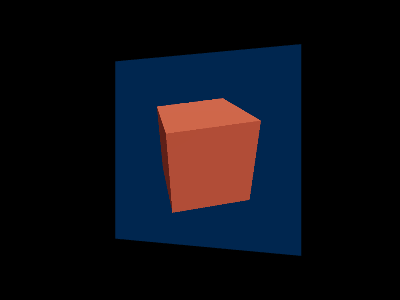
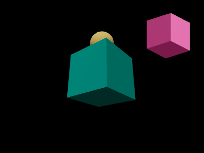
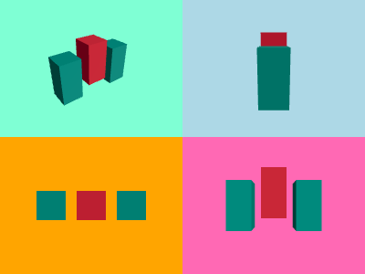
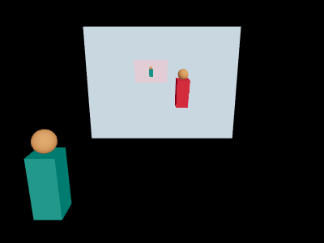

# Render targets

`useRenderTarget` makes a render target (an FBO): a texture the renderer draws a scene into instead of the canvas. As in react-three-fiber v10, you never pick the class yourself; on pixi-3d it is a `WebGLRenderTarget` on both the WebGL and the WebGPU backend, and its `texture` is a pixi `RenderTexture` that goes wherever a texture does.

## Basic usage

Fill a scene of its own through `createPortal`, draw it into the target in `useFrame`, and show `fbo.texture` on a mesh:

<!-- snippet: examples/render-targets/fbo.example.tsx#result -->

```tsx
import { Canvas, createPortal, useFrame, useRenderTarget } from '@react-fiber/threejs-compat';
import { Color, PerspectiveCamera, Scene } from '@react-fiber/threejs-compat/three';
import type { Mesh } from '@react-fiber/threejs-compat/three';
import { useRef, useState } from 'react';

function Monitor() {
  const fbo = useRenderTarget(512, 512);
  const [scene] = useState(() => {
    const virtual = new Scene();
    virtual.background = new Color('#1d3557');
    return virtual;
  });
  const [camera] = useState(() => {
    const lens = new PerspectiveCamera(50, 1, 0.1, 100);
    lens.position.set(0, 0, 4);
    return lens;
  });
  const box = useRef<Mesh>(null!);

  useFrame(({ renderer }, delta) => {
    box.current.rotation.x += delta;
    box.current.rotation.y += delta * 0.6;
    renderer.setRenderTarget(fbo);
    renderer.render(scene, camera);
    renderer.setRenderTarget(null);
  });

  return (
    <>
      {createPortal(
        <>
          <ambientLight intensity={0.5} />
          <directionalLight position={[2, 3, 4]} intensity={2} />
          <mesh ref={box}>
            <boxGeometry args={[1.5, 1.5, 1.5]} />
            <meshStandardMaterial color="#e76f51" />
          </mesh>
        </>,
        scene,
      )}
      <mesh rotation={[0, -0.3, 0]}>
        <planeGeometry args={[3, 3]} />
        <meshBasicMaterial map={fbo.texture} />
      </mesh>
    </>
  );
}

export function App() {
  return (
    <Canvas>
      <Monitor />
    </Canvas>
  );
}
```



`renderer.setRenderTarget(fbo)` points the next `render` at the target, and `setRenderTarget(null)` points it back at the canvas, exactly as in three.

r3f's shortest sample draws the root's own `scene` into the target and shows it on a plane in that same scene. That works as in three; hide the plane while the target draws, as three needs, so it doesn't sample the texture it draws into. On WebGPU, pixi-3d binds the textures of every material in the view, hidden ones' included, so a target a material samples is drawn into a twin texture of the same size and copied into its own.

## Argument forms

The hook takes r3f's forms. With no size, the target is the canvas's size in CSS pixels and follows it when the canvas resizes, keeping its texture:

```tsx
// canvas size (resizes with the canvas)
const fbo = useRenderTarget();

// canvas size with options
const fbo = useRenderTarget({ samples: 4 });

// square render target (512×512)
const fbo = useRenderTarget(512);

// square render target with options
const fbo = useRenderTarget(512, { depthBuffer: true });

// explicit dimensions
const fbo = useRenderTarget(512, 256);

// explicit dimensions with options
const fbo = useRenderTarget(512, 256, { samples: 4 });
```

The target is disposed when the component unmounts or its options change. r3f's never is, so this is one less thing to clean up.

## Options

| Option            | Default            | On pixi-3d                                                                |
| ----------------- | ------------------ | ------------------------------------------------------------------------- |
| `depthBuffer`     | `true`             | Kept; every scene pixi-3d draws gets its own depth                        |
| `stencilBuffer`   | `false`            | Kept                                                                      |
| `samples`         | `0`                | Above 0, pixi antialiases the target                                      |
| `type`            | `UnsignedByteType` | `HalfFloatType` and `FloatType` store floats, anything else 8 bits        |
| `magFilter`       | `LinearFilter`     | `NearestFilter` samples the nearest texel, anything else filters linearly |
| `generateMipmaps` | `false`            | Builds mipmaps after each render into the target                          |
| `format`, `count` | `RGBAFormat`, `1`  | Kept for three's shape: a target always has one RGBA texture              |

## The renderer's target API

`state.renderer` answers three's render target calls:

| Call                                                        | What it does                                                                                                                           |
| ----------------------------------------------------------- | -------------------------------------------------------------------------------------------------------------------------------------- |
| `setRenderTarget(target, face?, mip?)`, `getRenderTarget()` | Points renders at a target, a face of a cube target, or `null` for the canvas                                                          |
| `render(scene, camera)`                                     | Draws into the current target, over its viewport. Inside a target, tone mapping is off, as three draws a target in linear light        |
| `setViewport`, `setScissor`, `setScissorTest`               | three's rects, in CSS pixels from the canvas's bottom-left corner; a target's own `viewport` and `scissor` apply while it is set       |
| `autoClear`, `clear()`, `clearColor()`, `clearDepth()`      | Clear the canvas or the target, inside the scissor rect while the scissor test is on                                                   |
| `setClearColor(color, alpha)`                               | Takes a three `Color` or any pixi colour                                                                                               |
| `readRenderTargetPixels`, `readRenderTargetPixelsAsync`     | Read a rect back as three's linear bytes, rows from the bottom up; on WebGPU only the async one reads, as with three's WebGPU renderer |

A camera's `aspect` decides its projection, as in three: a square camera drawn into a wide target comes out squeezed, and stretches back on a square plane.

## Drawing over the scene

A job in the render phase takes rendering over from the root. r3f's Viewcube demo draws the scene, then a second scene with its own camera over it, without clearing the first:

<!-- snippet: examples/render-targets/hud.example.tsx#render -->

```tsx
useFrame(
  ({ renderer }) => {
    matrix.copy(defaultCamera.matrix).invert();
    cube.current.quaternion.setFromRotationMatrix(matrix);
    renderer.autoClear = true;
    renderer.render(defaultScene, defaultCamera);
    renderer.autoClear = false;
    renderer.clearDepth();
    renderer.render(scene, camera);
  },
  { phase: 'render' },
);
```



The view cube lives in a portal with its own camera and a higher event priority, so the pointer reaches it before the scene behind. Each scene's view starts with fresh depth on pixi-3d, so `clearDepth` changes nothing there, but keep it: three needs it.

`setRenderOverride(store, render)` replaces the root's render with your own function in the same way, for code outside a component.

## Several views

`setViewport` and `setScissor` split the canvas. r3f's MultiView demo gives each view a portal with its own camera and size, and draws it into its quarter from the render phase:

<!-- snippet: examples/render-targets/multi-view.example.tsx#container -->

```tsx
function Container({ clearColor, corner }: { clearColor: Color; corner: Vector2 }) {
  const { size, camera, scene } = useThree();
  const [x, y] = corner as [number, number];

  useFrame(
    ({ renderer }) => {
      const left = Math.floor(size.width * x);
      const bottom = Math.floor(size.height * y);
      renderer.setViewport(left, bottom, size.width, size.height);
      renderer.setScissor(left, bottom, size.width, size.height);
      renderer.setScissorTest(true);
      renderer.setClearColor(clearColor);
      renderer.render(scene, camera);
    },
    { phase: 'render' },
  );

  return null;
}
```



## Portals

`createPortal` renders children into another scene, optionally with state of their own. Combined with a render target, a portal shows another world through a plane. r3f's Portals demo copies the default camera into the portal's camera each frame and raycasts events through the plane's `uv`:

<!-- snippet: examples/render-targets/portals.example.tsx#portal -->

```tsx
function Portal({
  children,
  scale,
  ...props
}: { children: ReactNode; scale: [number, number, number] } & ThreeElements['mesh']) {
  const ref = useRef<Mesh>(null!);
  const fbo = useRenderTarget();
  const events = useThree((state) => state.events);
  const scene = useMemo(() => new Scene(), []);
  const [width, height] = scale;
  const camera = useMemo(() => new PerspectiveCamera(50, width / height, 0.1, 1000), [width, height]);

  useFrame((state) => {
    camera.position.copy(state.camera.position);
    camera.rotation.copy(state.camera.rotation);
    state.renderer.setRenderTarget(fbo);
    state.renderer.render(scene, camera);
    state.renderer.setRenderTarget(null);
  });

  const compute = useCallback<ComputeFunction>(
    (event, state, previous) => {
      if (!previous) return;
      if (!previous.raycaster.camera) previous.events.compute!(event, previous, previous.previousRoot?.getState());
      const [intersection] = previous.raycaster.intersectObject(ref.current);
      if (!intersection) return;
      const uv = intersection.uv!;
      state.raycaster.setFromCamera(state.pointer.set(uv.x * 2 - 1, uv.y * 2 - 1), camera);
    },
    [camera],
  );

  return (
    <>
      <mesh ref={ref} scale={scale} {...props}>
        <planeGeometry />
        <meshBasicMaterial map={fbo.texture} />
      </mesh>
      {/* oxlint-disable-next-line react/refs -- compute reads the ref on pointer events, after render */}
      {createPortal(children, scene, { camera, events: { compute, priority: events.priority - 1 } })}
    </>
  );
}
```



The state a portal injects reaches everything inside it, nested portals included:

<!-- snippet: examples/render-targets/inject.example.tsx#inject -->

```tsx
function Portals() {
  const [scene1] = useState(() => new Scene());
  const [scene2] = useState(() => new Scene());

  return (
    <>
      <Cube position={[-0.8, 0, 0]} color="hotpink" />
      {createPortal(
        <group>
          <Cube position={[0, 0.6, 0]} color="lightblue" />
          {createPortal(<Cube position={[0.8, 0, 0]} color="aquamarine" />, scene2, { camera: customCamera2 })}
        </group>,
        scene1,
        { camera: customCamera1 },
      )}
      <primitive object={scene1} />
      <primitive object={scene2} />
    </>
  );
}
```

A portal into the camera keeps an object ahead of the lens wherever the camera goes:

<!-- snippet: examples/render-targets/camera-portal.example.tsx#portal -->

```tsx
function PortalTestScene() {
  const { camera, renderer } = useThree();

  return (
    <>
      <color attach="background" args={['#1e1e1e']} />
      <ambientLight intensity={0.5} />
      <directionalLight position={[5, 5, 5]} intensity={1} />
      <mesh position={[0, 0, -5]}>
        <boxGeometry args={[1, 1, 1]} />
        <meshStandardMaterial color="orange" />
      </mesh>
      <orbitControls args={[camera, renderer.domElement]} />
      {createPortal(
        <mesh position={[0, 0, -2]} scale={0.2}>
          <boxGeometry />
          <meshStandardMaterial color="hotpink" />
        </mesh>,
        camera,
      )}
    </>
  );
}
```

## Cube targets

A `WebGLCubeRenderTarget` holds six faces, which a `CubeCamera` draws from a point. Its texture can light a scene as its environment, as `<Environment>` does with its children (see [Environment](environment.md)):

```tsx
import { WebGLCubeRenderTarget } from '@react-fiber/threejs-compat/three';

const target = useMemo(() => new WebGLCubeRenderTarget(256), []);
const camera = useRef<CubeCamera>(null!);

useFrame(({ renderer, scene }) => camera.current.update(renderer, scene));

return <cubeCamera ref={camera} args={[0.1, 100, target]} />;
```

## What differs

- A target stores its picture encoded for display, as pixi-3d draws to the canvas, and materials decode it when they sample it; three stores linear values. `readRenderTargetPixels` decodes it, so it hands back three's bytes.
- `dispose()` destroys the texture for good, where three's lets a target be drawn into again.
- Only 8-bit 2D targets can be read back.
- Drawing the same scene into a target and onto the canvas in one frame switches its tone mapping each time, which costs pixi-3d a shader lookup per mesh.
- A scissor rect limits clears, and a viewport where a scene is drawn; a scissor smaller than the viewport doesn't clip the scene itself.
