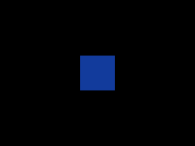
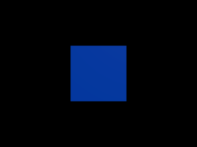
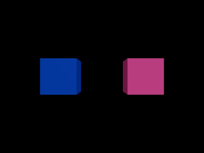

# Events and interaction

With the loop running, the next step is to make the mesh react to the pointer: here, a click that makes the cube bigger. The events are react-three-fiber's own, dispatched by r3f's event system, so they bubble, capture and order exactly as in r3f.

## User interaction

Any object that has a `raycast` method receives events, such as a mesh:

<!-- snippet: examples/events-and-interaction/handlers.example.tsx#handlers -->

```tsx
<mesh
  onClick={() => console.log('click')}
  onContextMenu={() => console.log('context menu')}
  onDoubleClick={() => console.log('double click')}
  onWheel={() => console.log('wheel spins')}
  onPointerUp={() => console.log('up')}
  onPointerDown={() => console.log('down')}
  onPointerOver={() => console.log('over')}
  onPointerOut={() => console.log('out')}
  onPointerEnter={() => console.log('enter')}
  onPointerLeave={() => console.log('leave')}
  onPointerMove={() => console.log('move')}
  onPointerMissed={() => console.log('missed')}
>
  <boxGeometry />
  <meshStandardMaterial color="royalblue" />
</mesh>
```



Start with the click a DOM element would have:

<!-- snippet: examples/events-and-interaction/hello.example.tsx#box -->

```tsx
<mesh onClick={() => alert('Hello')}>
  <boxGeometry />
  <meshStandardMaterial color="royalblue" />
</mesh>
```


## Changing the mesh

Keep whether the mesh is active in state:

<!-- snippet: examples/events-and-interaction/active.example.tsx#state -->

```tsx
const [active, setActive] = useState(false);
```

and scale the mesh by it:

<!-- snippet: examples/events-and-interaction/active.example.tsx#box -->

```tsx
<mesh scale={active ? 1.5 : 1} onClick={() => setActive(!active)}>
  <boxGeometry />
  <meshStandardMaterial color="royalblue" />
</mesh>
```



Click the mesh and it scales up and down. In three steps it:

- has a click handler,
- keeps whether it is active in state,
- sets its scale from that state.

**Try this:**

- Change other props of the mesh, such as its `position`, or the `color` of its material.
- Use `onPointerOver` and `onPointerOut` to change the mesh while the pointer is over it:

<!-- snippet: examples/events-and-interaction/hover.example.tsx#box -->

```tsx
<mesh
  {...props}
  scale={active ? 1.5 : 1}
  onClick={() => setActive(!active)}
  onPointerOver={() => setHovered(true)}
  onPointerOut={() => setHovered(false)}
>
  <boxGeometry />
  <meshStandardMaterial color={hovered ? 'hotpink' : 'royalblue'} />
</mesh>
```



## The event object

A handler gets r3f's event: the DOM event's fields, and what the ray hit. `e.object` is the object that was hit, `e.eventObject` the one whose handler runs, `e.point` the hit in world space and `e.distance` how far along the ray it was; `e.face`, `e.uv` and `e.instanceId` say where on the object. `e.stopPropagation()` stops the event at the nearest object, as in r3f. [Events](events.md) has every field, how events bubble, pointer capture and the event settings.

## Next steps

Pictures and models make a scene: load [models](loading-models.md) and [textures](loading-textures.md).
