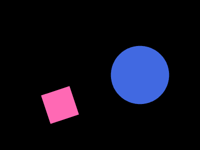

# Animating 2D

2D animates the way [3D does in r3f](../../__docs__/basic-animations.md): `useFrame` runs a callback before every frame, with the root's state and the frame's `delta`, and the callback changes objects through their refs. Changing them there, instead of through React state, re-renders nothing.

## Through a ref

<!-- snippet: examples/2d/animation.example.tsx#ref -->

```tsx
function Bobbing() {
  const sprite = useRef<Sprite>(null);

  useFrame((state) => {
    sprite.current!.y = 150 + Math.sin(state.elapsed * 4) * 60;
    sprite.current!.rotation += 0.05;
  });

  return <sprite2D ref={sprite} texture={Texture.WHITE} tint="hotpink" width={60} height={60} anchor={0.5} x={120} />;
}
```

## Through the draw prop

A graphics redraws when it gets a new `draw` function, so drawing that changes every frame can go through state. Each frame re-renders the component and the graphics is cleared and drawn again:

<!-- snippet: examples/2d/animation.example.tsx#draw -->

```tsx
function Pulse() {
  const [radius, setRadius] = useState(20);

  useFrame((state) => setRadius(40 + Math.sin(state.elapsed * 3) * 20));

  return <graphics2D x={280} y={150} draw={(graphics) => graphics.circle(0, 0, radius).fill('royalblue')} />;
}
```



For many shapes, keep a ref to the graphics and draw into it in `useFrame` instead: `graphics.clear().circle(...)`.

pixi's `Ticker` isn't what draws: the root's frameloop is, so `frameloop="demand"` and `invalidate()` work for 2D as for 3D. An `<animatedSprite2D>` plays on pixi's shared ticker when you call `play()`; to keep it on the root's clock, set its `currentFrame` in `useFrame`, as [Loading textures and spritesheets](loading-2d.md) does.
