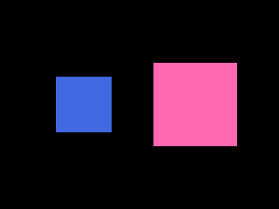
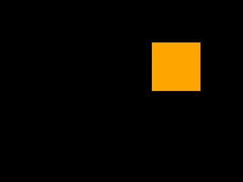

# 2D events

2D elements take react-three-fiber's event handlers, and they run in the same event system as the 3D: one pointer event reaches 2D and 3D objects in one ordered list, so `stopPropagation`, pointer capture and hover work across both.

## Handlers

<!-- snippet: examples/2d/events.example.tsx#button -->

```tsx
function Button({ x }: { x: number }) {
  const [hovered, setHovered] = useState(false);
  const [active, setActive] = useState(false);

  return (
    <sprite2D
      texture={Texture.WHITE}
      tint={hovered ? 'hotpink' : 'royalblue'}
      width={active ? 120 : 80}
      height={active ? 120 : 80}
      anchor={0.5}
      x={x}
      y={150}
      cursor="pointer"
      onClick={(event: ThreeEvent2D<MouseEvent>) => {
        event.stopPropagation();
        setActive(!active);
      }}
      onPointerOver={() => setHovered(true)}
      onPointerOut={() => setHovered(false)}
    />
  );
}
```



The handlers are r3f's: `onClick`, `onDoubleClick`, `onContextMenu`, `onWheel`, `onPointerDown`, `onPointerUp`, `onPointerMove`, `onPointerOver`, `onPointerOut`, `onPointerEnter`, `onPointerLeave`, `onPointerCancel`, `onPointerMissed` and `onLostPointerCapture`, with r3f's meanings. A handler on a container gets the events of its children too, as r3f bubbles them up the tree.

## What is hit

A handler makes an element interactive, as in r3f; `eventMode="none"` opts it and its children out. What counts as a hit is pixi's own test, run by pixi's `EventBoundary`: a sprite's texture rectangle, a graphics' shapes, a `hitArea` when there is one, and a mask or a parent's `hitArea` leaves out what falls outside it. `interactiveChildren={false}` leaves a container's children out.

Hits are ordered by what is drawn in front: 2D over the 3D is hit before any 3D object, in draw order, and 2D behind the 3D after every 3D object. So a HUD button that stops propagation keeps the click from the mesh behind it.

## The event

A handler gets r3f's event, with `object` and `eventObject` as pixi.js containers and three fields for 2D:

- `global`: the pointer in the canvas's CSS pixels. Like r3f's `pointer`, it is the root's live point, which every pointer event moves; copy it to keep it.
- `local`: the pointer in the local space of the object that was hit.
- `getLocalPosition(container)`: the pointer, as `global` has it now, in any container's space.

2D hits sort before 3D ones by a negative `distance`; there is no `face` or `uv`.

## Dragging

Capture the pointer on pointerdown and the element keeps getting its moves when the pointer leaves it; read `global` for where the pointer is now:

<!-- snippet: examples/2d/drag.example.tsx#drag -->

```tsx
<sprite2D
  texture={Texture.WHITE}
  tint="orange"
  width={80}
  height={80}
  anchor={0.5}
  position={position}
  cursor="grab"
  onPointerDown={(event: ThreeEvent2D<PointerEvent>) => {
    event.target.setPointerCapture(event.pointerId);
    offset.current = { x: position[0] - event.global.x, y: position[1] - event.global.y };
  }}
  onPointerMove={(event: ThreeEvent2D<PointerEvent>) => {
    if (!event.target.hasPointerCapture(event.pointerId)) return;
    setPosition([event.global.x + offset.current.x, event.global.y + offset.current.y]);
  }}
  onPointerUp={(event: ThreeEvent2D<PointerEvent>) => event.target.releasePointerCapture(event.pointerId)}
/>
```



## The cursor

`cursor` sets the canvas's CSS cursor while the pointer is over the element, or over a child of it that is hit, as pixi does.

## pixi's own event system

pixi.js's `EventSystem` is turned off on the renderer: r3f's handles the canvas's pointer events for 2D and 3D alike. pixi's `on('pointerdown')` listeners and `onpointerdown` fields don't fire; use the handlers above.
