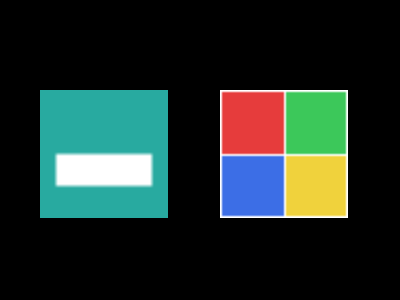

# Loading textures and spritesheets

2D loads through r3f's Suspense model, as [3D textures do](../../__docs__/loading-textures.md): a hook suspends until its asset has loaded, and a `<Suspense>` boundary shows a fallback meanwhile.

## Textures

`useTexture` gives a texture a `<sprite2D>` takes directly. It is three's `Texture` from `react-pixi-fiber/three`, which extends pixi's, so the same texture can be a sprite's and a material's:

<!-- snippet: examples/2d/spritesheet.example.tsx#picture -->

```tsx
function Picture() {
  const texture = useTexture('/textures/quadrants.png');

  return <sprite2D texture={texture} x={220} y={90} width={128} height={128} />;
}
```

## Spritesheets, bitmap fonts and other assets

`useAsset` loads anything pixi's `Assets.load` loads, a spritesheet, a bitmap font, a texture, JSON, and suspends until it is ready. It is `useLoader` with `AssetsLoader`, so its results are cached by URL and `useLoader.preload` and `useLoader.clear` work with it:

<!-- snippet: examples/2d/spritesheet.example.tsx#walker -->

```tsx
function Walker() {
  const sheet = useAsset<Spritesheet>('/sprites/walk.json');
  const sprite = useRef<AnimatedSprite>(null);

  useFrame((state) => {
    sprite.current!.currentFrame = Math.floor(state.elapsed * 8) % sprite.current!.totalFrames;
  });

  return <animatedSprite2D ref={sprite} args={[sheet.animations.walk]} x={40} y={90} scale={4} />;
}
```



A bitmap font is used by its name once it has loaded:

```tsx
function Score() {
  useAsset('/fonts/blocks.fnt');

  return <bitmapText2D text="PIXI 2D" style={{ fontFamily: 'Blocks', fontSize: 28, fill: 'white' }} />;
}
```

`useLoader.clear` forgets an asset in React only; `Assets.unload` frees it.
