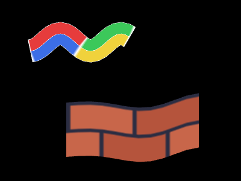

# Meshes

A 2D mesh draws a texture over triangles of your own, so the picture can bend: along a rope, over a grid that ripples, or into a perspective. Each of pixi.js's meshes is an element: `<meshRope2D>`, `<meshPlane2D>`, `<meshSimple2D>`, `<perspectiveMesh2D>` and `<mesh2D>`.

They need their texture and shape when they are made, so their options go in `args`. Memoize the options, since a new object would build the mesh again on every render, and move the mesh in `useFrame` through its ref.

## Ropes

A `<meshRope2D>` stretches its texture along a list of points. Its geometry keeps the points and rebuilds itself from them each frame, so moving the points moves the rope:

<!-- snippet: examples/2d/meshes.example.tsx#rope -->

```tsx
function Snake() {
  const texture = useTexture('/textures/quadrants.png');
  const rope = useRef<MeshRope>(null);
  const options = useMemo(
    () => ({ texture, points: Array.from({ length: 24 }, (_, i) => new Point(i * 12, 0)) }),
    [texture],
  );

  useFrame((state) => {
    const { points } = rope.current!.geometry as RopeGeometry;
    for (let i = 0; i < points.length; i++) points[i].y = Math.sin(i * 0.45 + state.elapsed * 5) * 24;
  });

  return <meshRope2D ref={rope} args={[options]} x={50} y={70} scale={0.6} />;
}
```

## Planes

A `<meshPlane2D>` is a grid of `verticesX` by `verticesY` points over its texture. Writing the grid's positions, then calling `update()` on the buffer, bends the picture:

<!-- snippet: examples/2d/meshes.example.tsx#plane -->

```tsx
function Flag() {
  const texture = useTexture('/textures/bricks.png');
  const plane = useRef<MeshPlane>(null);
  const options = useMemo(() => ({ texture, verticesX: 12, verticesY: 6 }), [texture]);

  useFrame((state) => {
    const buffer = plane.current!.geometry.getBuffer('aPosition');
    const positions = buffer.data;
    for (let i = 0; i < positions.length; i += 2) {
      const column = (i / 2) % 12;
      const row = Math.floor(i / 2 / 12);
      positions[i + 1] = (row / 5) * texture.height + Math.sin(column * 0.6 - state.elapsed * 6) * column * 0.5;
    }
    buffer.update();
  });

  return <meshPlane2D ref={plane} args={[options]} x={110} y={170} width={220} height={90} />;
}
```



## Simple meshes and perspective

A `<meshSimple2D>` takes its `vertices`, `uvs` and `indices` as typed arrays. `vertices` is a prop as well, so a new array reshapes it:

```tsx
<meshSimple2D args={[{ texture, vertices, uvs, indices }]} vertices={stretched} />
```

A `<perspectiveMesh2D>` maps its texture onto four corners, as a card seen at an angle; `setCorners` moves them:

```tsx
useFrame((state) => {
  const squeeze = Math.abs(Math.sin(state.elapsed * 2)) * 30;
  card.current!.setCorners(0, 0, 120, squeeze, 120, 120 - squeeze, 0, 120);
});
```

`<mesh2D>` draws any `MeshGeometry`, which it needs when it is made: pass `{ geometry, texture }` in `args`.
