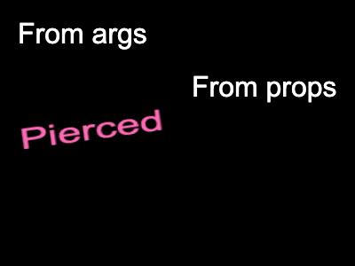
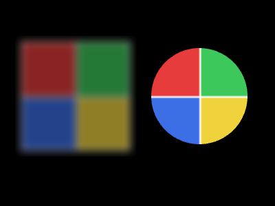
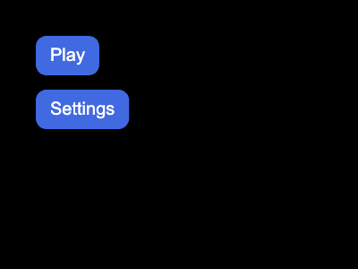

# 2D objects, properties and arguments

2D elements follow react-three-fiber's rules for [objects, properties and arguments](../../__docs__/objects.md): the element makes the object, `args` are its constructor's arguments, props set its fields, dashes pierce into nested objects, and `attach` puts a child somewhere on its parent other than among its children.

## Arguments

`args` is the list of arguments the class's constructor takes, any of its forms. pixi.js's constructors take an options object:

<!-- snippet: examples/2d/args-and-props.example.tsx#args -->

```tsx
<text2D args={[{ text: 'From args', style: { fill: 'white', fontSize: 32 } }]} x={20} y={20} />
```

The object is built again when `args` change, so use them for what a class needs at construction, such as a mesh's geometry or an animated sprite's frames, and props for the rest.

## Properties

A prop sets the field of the same name: `x`, `y`, `alpha`, `tint`, `rotation`, `angle`, `zIndex`, `visible`, `blendMode`, `eventMode`, `cursor`, `hitArea`, `mask`, `texture`, `text`, `style`. A point takes r3f's forms: one number for both axes (`anchor={0.5}`, `scale={2}`), an array (`position={[10, 20]}`), or a point.

<!-- snippet: examples/2d/args-and-props.example.tsx#props -->

```tsx
<text2D text="From props" style={{ fill: 'white', fontSize: 32 }} anchor={[1, 0]} position={[380, 80]} />
```

## Piercing

A dash sets a field of a field: `scale-x`, `pivot-y`, `style-fill`, `style-fontSize`.

<!-- snippet: examples/2d/args-and-props.example.tsx#pierce -->

```tsx
<text2D text="Pierced" style={{ fontSize: 32 }} style-fill="hotpink" scale-x={1.5} x={20} y={140} angle={-8} />
```



## Children

2D children of a 2D element are its pixi children, in React's order. Keyed children move when their keys do, and `zIndex` sorts children in a container with `sortableChildren`. pixi.js 8 lets only containers hold children, so nest under `<container2D>`.

## Attach

A filter, a mask or a graphics context is no child: it attaches to a field of its parent. `attach="filters-0"` puts a filter first in the parent's `filters`, `filters-1` second, and unmounting one takes it out again. `attach="mask"` makes a 2D element the parent's mask, drawn in the parent's own space.

<!-- snippet: examples/2d/attach.example.tsx#filters -->

```tsx
<sprite2D texture={texture} x={30} y={60} width={160} height={160}>
  <blurFilter2D attach="filters-0" strength={4} />
  <alphaFilter2D attach="filters-1" alpha={0.6} />
</sprite2D>
```

<!-- snippet: examples/2d/attach.example.tsx#mask -->

```tsx
<container2D x={210} y={60}>
  <sprite2D texture={texture} width={160} height={160} />
  <graphics2D attach="mask" draw={(graphics) => graphics.circle(80, 80, 70).fill('white')} />
</container2D>
```



`<graphicsContext2D attach="context" draw={...} />` gives a graphics a context of its own. To share one context between several graphics, make it once and pass it in `args`: `<graphics2D args={[context]} />`.

## Your own classes

A class of your own, extending one of pixi.js's, becomes an element with r3f's `extend`, under a name ending in `2D`. Type its element by adding it to `ThreeElements`:

<!-- snippet: examples/2d/extend.example.tsx#result -->

```tsx
import { Container, Graphics, Text } from 'pixi.js';
import { Canvas, extend } from 'react-pixi-fiber';
import type { ThreeElement } from 'react-pixi-fiber';

/** A rounded button with a label, built from pixi.js's own classes */
class Button extends Container {
  private readonly _background = new Graphics();
  private readonly _label = new Text({ text: '', style: { fill: 'white', fontSize: 20 } });

  constructor(label = 'Button') {
    super();
    this.addChild(this._background, this._label);
    this.label = label;
  }

  public set label(value: string) {
    this._label.text = value;
    this._label.position.set(16, 10);
    this._background
      .clear()
      .roundRect(0, 0, this._label.width + 32, 44, 12)
      .fill('royalblue');
  }

  public get label(): string {
    return this._label.text;
  }
}

extend({ Button2D: Button });

declare module 'react-pixi-fiber' {
  interface ThreeElements {
    button2D: ThreeElement<typeof Button>;
  }
}

function Toolbar() {
  return (
    <>
      <button2D args={['Play']} x={40} y={40} />
      <button2D label="Settings" x={40} y={100} />
    </>
  );
}

export function App() {
  return (
    <Canvas>
      <Toolbar />
    </Canvas>
  );
}
```



## Disposal

Unmounting an element destroys its object and its children's, with the filters and contexts attached to it, as r3f disposes three objects. A texture or a context passed in as a prop or in `args` is left alone, since something else may use it. `dispose={null}` keeps an element's object alive, and `<primitive object={sprite} />` puts an object you made in the tree without React owning it.
