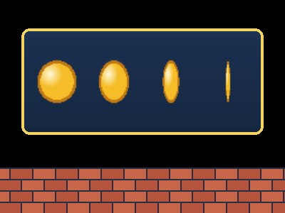
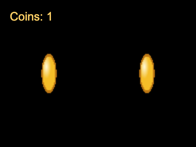

# Sprites and spritesheets

A sprite draws a texture. pixi.js has four kinds, and each is an element: `<sprite2D>` draws it once, `<tilingSprite2D>` repeats it across an area, `<nineSliceSprite2D>` stretches it without stretching its borders, and `<animatedSprite2D>` plays a list of textures. Textures load with `useTexture`, and spritesheets with `useAsset`, as [Loading 2D assets](loading-2d.md) shows.

## Sprite

A `<sprite2D>` takes its `texture` as a prop, which can change like any other. `anchor` is the point of the texture at its `x` and `y`, from 0 to 1, so `anchor={0.5}` turns and scales it about its centre. `width` and `height` scale it to a size in pixels, and `tint` multiplies its colours.

```tsx
<sprite2D texture={texture} anchor={0.5} x={200} y={150} width={120} height={120} tint="hotpink" />
```

## Tiling sprites

A `<tilingSprite2D>` fills its `width` and `height` with copies of its texture. `tilePosition`, `tileScale` and `tileRotation` move, scale and turn the tiles inside it, which scrolls a background when `useFrame` moves `tilePosition`:

<!-- snippet: examples/2d/sprites.example.tsx#tiling -->

```tsx
function Floor() {
  const texture = useTexture('/textures/bricks.png');
  const floor = useRef<TilingSprite>(null);

  useFrame((_, delta) => {
    floor.current!.tilePosition.x -= delta * 60;
  });

  return <tilingSprite2D ref={floor} texture={texture} y={236} width={400} height={64} />;
}
```

## Nine-slice sprites

A `<nineSliceSprite2D>` cuts its texture into nine parts by four border widths. Stretched, its corners keep their size and its edges stretch along one axis only, so a panel or a button keeps its border at any size. The borders are constructor options, so they go in `args`; memoize the options object, since a new one each render would build the sprite again:

<!-- snippet: examples/2d/sprites.example.tsx#nine-slice -->

```tsx
function Frame() {
  const texture = useTexture('/textures/panel.png');
  const slices = useMemo(
    () => ({ texture, leftWidth: 14, topHeight: 14, rightWidth: 14, bottomHeight: 14 }),
    [texture],
  );

  return <nineSliceSprite2D args={[slices]} x={30} y={40} width={340} height={150} />;
}
```

## Animated sprites

An `<animatedSprite2D>` plays a list of textures, such as a spritesheet's animation, which it takes in `args`. `playing` plays or stops it, `animationSpeed` sets how many frames it moves on each frame of the canvas, and `loop` whether it starts again at the end:

<!-- snippet: examples/2d/sprites.example.tsx#coins -->

```tsx
function Coins() {
  const sheet = useAsset<Spritesheet>('/sprites/coin.json');

  return (
    <>
      {[0.1, 0.15, 0.2, 0.25].map((speed, i) => (
        <animatedSprite2D
          key={speed}
          args={[sheet.animations.spin]}
          playing
          animationSpeed={speed}
          anchor={0.5}
          x={80 + i * 80}
          y={115}
          scale={1.5}
        />
      ))}
    </>
  );
}
```



Animated sprites play on the canvas's clock, as `useFrame` does, rather than on pixi's shared ticker: they follow the canvas's `frameloop`, stop with it, and keep a `frameloop="demand"` canvas drawing while they play. `play()`, `stop()`, `gotoAndPlay()` and `gotoAndStop()` work on a ref too. Set `autoUpdate` to `true` to put a sprite back on pixi's shared ticker.

### Playing once

With `loop={false}` the sprite stops on its last frame and calls `onComplete`. `onLoop` and `onFrameChange` are props too. Here a click restarts a coin's spin with `gotoAndPlay(0)`, faster and once, and `onComplete` collects it:

<!-- snippet: examples/2d/collect.example.tsx#coin -->

```tsx
function Coin({ x, onCollected }: { x: number; onCollected: () => void }) {
  const sheet = useAsset<Spritesheet>('/sprites/coin.json');
  const coin = useRef<AnimatedSprite>(null);
  const [collecting, setCollecting] = useState(false);
  const [collected, setCollected] = useState(false);

  return (
    <animatedSprite2D
      ref={coin}
      args={[sheet.animations.spin]}
      playing={!collected}
      loop={!collecting}
      animationSpeed={collecting ? 0.5 : 0.13}
      visible={!collected}
      anchor={0.5}
      x={x}
      y={150}
      scale={2}
      cursor="pointer"
      onClick={() => {
        coin.current!.gotoAndPlay(0);
        setCollecting(true);
      }}
      onComplete={() => {
        setCollected(true);
        onCollected();
      }}
    />
  );
}
```



## Spritesheets

`useAsset` loads a spritesheet's JSON and its image together and suspends until both are ready. `sheet.textures` has each frame by name and `sheet.animations` each animation's frames in order, ready for `<sprite2D texture={sheet.textures['coin-0']} />` or `<animatedSprite2D args={[sheet.animations.spin]} />`.
